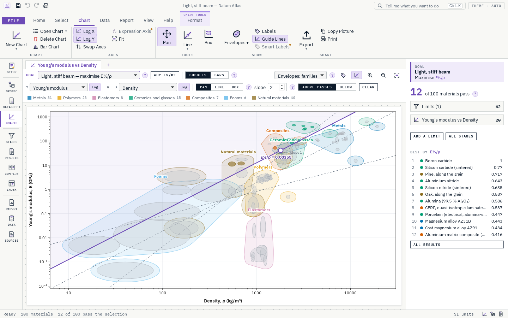
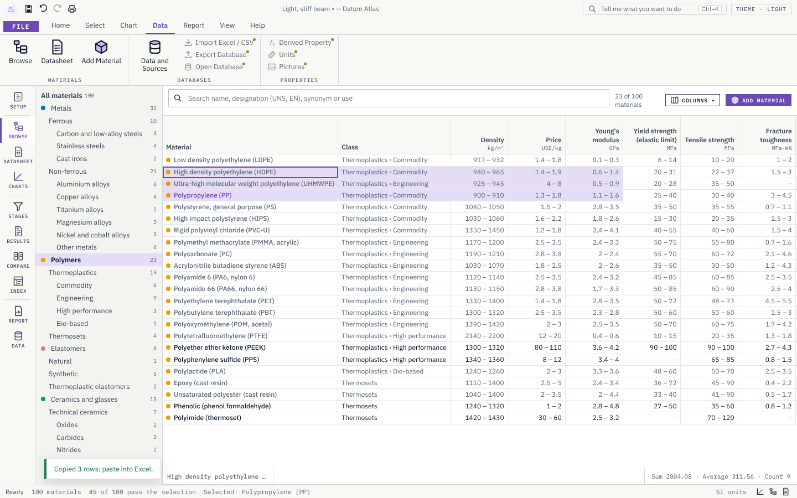
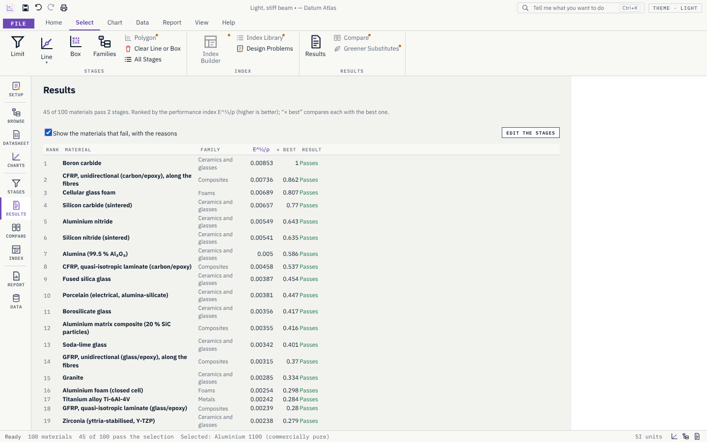
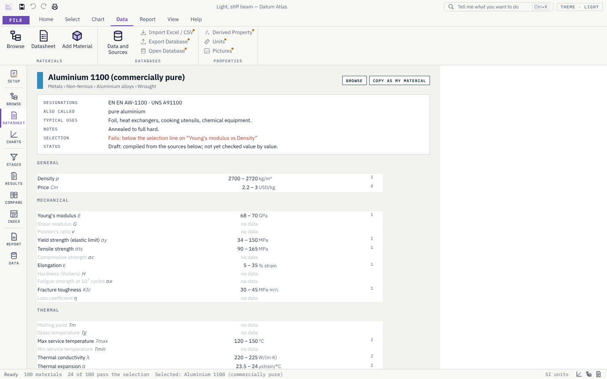
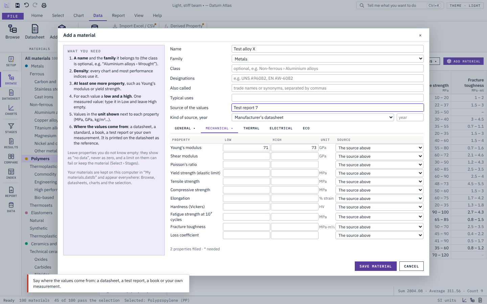
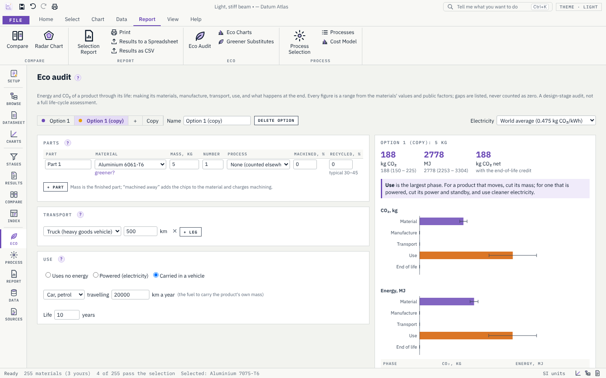
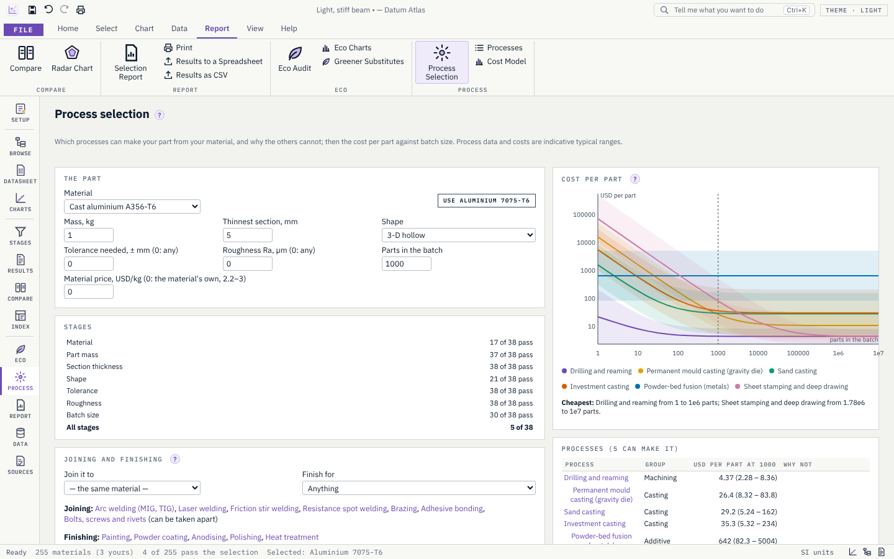
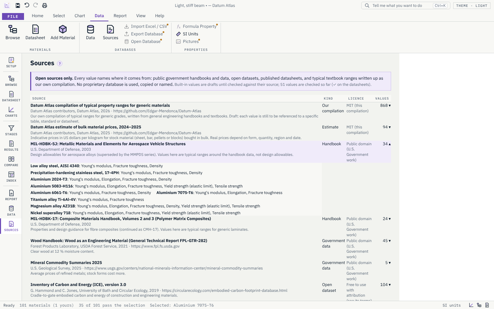

<div align="center">


# Datum Atlas

**A materials workbench for Windows: referenced materials data, property charts and selection, eco audit, process selection and microstructures, in modules.**

[](https://github.com/Edgar-Mendonca/Datum-Atlas/releases/latest)
[](https://github.com/Edgar-Mendonca/Datum-Atlas/actions/workflows/ci.yml)
[](https://github.com/Edgar-Mendonca/Datum-Atlas/releases)
[](LICENSE)
[](https://github.com/Edgar-Mendonca/Datum-Atlas/releases/latest)
[](crates/core)
[](https://tauri.app)
[](ui/src)

[](https://github.com/Edgar-Mendonca/Datum-Atlas/releases/latest)
[](CHANGELOG.md)
[](https://github.com/Edgar-Mendonca/Datum-Atlas/issues/new)
[](docs/MEMORY.md)

</div>



## What it does

The **Datum Atlas Guide** (PDF, with pictures) is on every release page, and Help › Guide in the app downloads it.

Datum Atlas is part of Datum; see its page: https://edgar-mendonca.github.io/Datum/apps/atlas

Datum Atlas helps engineers, designers and students pick a material and show why it is the right one:

1. **Pick a design goal** (light stiff beam, cheap strong tie, spring, heat sink…) or write down the requirements: what the part does, what it must meet, what to minimise.
2. **See every material on a property chart**: two properties on log axes; each material is a bubble spanning its ranges, each family has its envelope.
3. **Select**: limits (max service temperature ≥ 150 °C, price ≤ 5 USD/kg, recyclable), a **selection line** for a performance index (E^½/ρ for a light, stiff beam is a line of slope 2), a band, a box, a drawn shape, or whole families left out.
4. **Rank, compare and report**: the materials that pass, ranked, and the reason every other one fails; the best side by side; a report that documents the choice.

## Modules (0.3.10)

| Module | What it is for |
| --- | --- |
| **Library** | Every material with its referenced values; your own materials and databases; import and export |
| **Select** | Property charts, design goals and indices, selection stages, ranked results, compare, the report |
| **Eco** | Energy and CO₂ through a product's life; greener substitutes |
| **Make** | Which processes can make your part, and the cost against batch size |
| **Microstructure** | Typical structures of every class of material; image analysis of your micrographs (phase fraction, porosity, particles) |
| **Testing** | Your test data: tensile curves and results with statistics, hardness statistics, S–N curves (Basquin), creep rupture (Larson–Miller); the results become a material of your own |
| **Crystal** | The elements on a periodic table, with referenced values; compositions (wt % and at %); crystal structures, plane spacings and angles, X-ray powder patterns and stereographic projections |

On the way: image analysis, synthetic structures, EBSD, DIC, corrosion, heat treatment and phase diagrams.

## Features (0.3.10)

- **About 250 materials** from every family: metals, polymers, elastomers, ceramics and glasses, composites, foams and natural materials. **Every value has a reference**, compiled from open and public sources only (government handbooks, NIST, USGS, the Wood Handbook, open datasets, university notes, producers' datasheets and typical textbook ranges). No proprietary database is used. Gaps stay gaps, never zero. 73 values are checked against published datasheets so far (marked ✓).
- **Durability ratings** for every material (water, acids, alkalis, sunlight, fire), and fatigue strength and resistivity for the metals.
- **25 design goals and 52 performance indices**, low-carbon and low-energy ones among them. A goal sets the axes, draws the selection line of the right slope through the best materials, adds the limits it needs and ranks the results; goals with two constraints set up two charts. “Why?” explains the function, constraint, objective and free variable. An **index builder** makes your own.
- **Formula properties and axes**: define σy/ρ or any formula of the properties; it is calculated for every material, with its range, and works in charts, limits and tables.
- **Property charts** of any two properties, log or linear; family envelopes; hover for ranges, click for the datasheet; zoom, pan, guide lines; the best materials labelled with labels that keep apart; classic, publication and mono styles; **up to four charts side by side**. **Bar charts** of one property.
- **Selection**: limits, several selection lines, bands, boxes, drawn shapes and families left out. Results ranked by an index with “× best”, or by **weighted properties**; every failure explained.
- **Eco audit**: energy and CO₂ of a product from its materials to the end of its life (material, manufacture, transport, use, end of life), as ranges, for up to four design options, with the largest phase named and the break-even life. **Greener substitutes** find materials that do the same job with less CO₂.
- **Process selection** from 55 processes (casting, moulding, forming, composites, machining, 3D printing): the ones that can make your part from your material, why the others cannot, the **cost per part against batch size**, and joins and finishes that suit it. Castability, machinability and weldability for every metal and polymer.
- **Compare** up to six materials in a table and a **radar chart**, and print a **selection report** (with the eco audit and the manufacture) with the requirements, charts, shortlist, comparison and datasheets.
- **Your own data**: add materials by hand, **import from a spreadsheet or CSV**, open a colleague's database beside the built-in data, and save yours as a database, a spreadsheet or CSV. Results go to a spreadsheet too.
- **SI or imperial units** everywhere; derived properties such as specific stiffness, cost per volume and thermal diffusivity.
- **Browse** with a family tree and a spreadsheet-like table, **datasheets** with numbered references, a micrograph box and a link to the material's **typical structure**, and a **Sources** page.
- **The elements** (Crystal module): the 118 elements on a periodic table with referenced values, coloured by category or by a property, and the **composition** of a formula or an alloy in weight and atom percent. **Crystal calculators**: a structure's density, the spacing and angles of planes and directions, the X-ray powder pattern and a stereographic projection.
- **Tensile tests** (Testing module): import a test machine's export and get E, Rp0.2, Rm, Ag, A, the work to fracture, n and K for each specimen, with statistics and the curves; **hardness** statistics, **S–N curves** with Basquin's law and **creep rupture** on a Larson–Miller plot; and a material of your own made from all the results.
- **Image analysis** (Microstructure module): calibrate a micrograph from its scale bar, threshold a phase, and measure its area fraction and its particles' sizes and shapes.
- **? help** beside the tools, a Glossary, and **Tell Me** (Ctrl+K) for commands, goals and materials.
- Print or save as PDF; export charts as SVG or PNG, or copy them as a picture. Light, dark and auto themes; the in-app updater; recovery of unsaved work; damaged files never crash the app.

<table><tr>
<td></td>
<td></td>
</tr><tr>
<td></td>
<td></td>
</tr><tr>
<td></td>
<td></td>
</tr><tr>
<td colspan="2"></td>
</tr></table>

## Coming next

0.3.11 Image analysis 2. 0.3.12 Synthetic structures 1. 0.3.13 Synthetic structures 2. 0.3.14 EBSD 1. 0.3.15 EBSD 2. Then synthetic structures, EBSD, DIC, corrosion and heat treatment, step by step. See Help › Roadmap in the app, or [docs/MEMORY.md](docs/MEMORY.md).

## Command line

`datum-atlas-cli-x.y.z.exe` comes with every release. It reads the materials, runs a selection project and changes it through the same named operations the window uses. Nothing is saved unless you ask.

```
datum-atlas-cli search 6061                       # materials by name, designation or use
datum-atlas-cli material al-6061-t6               # a datasheet: values, units, sources
datum-atlas-cli new beam bracket.datlas           # start from a design problem
datum-atlas-cli results bracket.datlas --csv      # every material ranked, and why the others fail
datum-atlas-cli ops                               # the named operations, with examples
datum-atlas-cli apply bracket.datlas --op '{"Goal":{"chart":1,"goal":"tie-strong"}}' --save tie.datlas
datum-atlas-cli eco tie.datlas                    # the eco audit
datum-atlas-cli process tie.datlas                # process selection and cost
datum-atlas-cli export tie.datlas results.xlsx    # .datlas, .xlsx or .csv
```

`datum-atlas-cli mcp` is a Model Context Protocol server: an AI assistant can search the materials, read datasheets with their sources, set up and read a selection, run the eco audit and process selection, and save the project. Nothing is written unless it is asked to save. In the app, Help › Use with an AI Assistant has the settings to copy:

```json
{ "mcpServers": { "datum-atlas": { "command": "C:\\Tools\\datum-atlas-cli-x.y.z.exe", "args": ["mcp"] } } }
```

## Install

Download `DatumAtlas-x.y.z-setup.exe` from the [latest release](https://github.com/Edgar-Mendonca/Datum-Atlas/releases/latest) and run it (per-user install, no administrator rights). Windows SmartScreen may warn on the first install because the installer is not signed yet. Updates install from File › Updates.

## Build

Rust (stable), Node 22, and on Linux the WebKitGTK development libraries.

```
npm ci
npm run build:ui
cargo test --workspace
npx tauri build --bundles nsis
```

The engine (`crates/core`) holds the materials data, units, chart geometry and selection, with unit tests; the window (`ui/src`, SolidJS) only shows what it computes. `npm run test:ui` runs the Playwright tests against the real engine.

## Data

Values are in `data/*.json`, one file per family, with their sources in `data/sources.json`. Each value is `[low, high, source]`. Built-in values are “draft” until each one is checked against a published source; checked values list the property in the material's `checked` list and cite that datasheet, and the tests refuse a checked value that cites only our own compilation; corrections with a reference are welcome as issues or pull requests.

## Licence

MIT. See [LICENSE](LICENSE) and [NOTICE](NOTICE).

Product and file-format names are trademarks of their owners and are used only to describe file compatibility.

## Part of the Datum family

Free, open-source desktop tools for engineers, scientists, researchers and analysts: [edgar-mendonca.github.io/Datum](https://edgar-mendonca.github.io/Datum). MIT licence; see [NOTICE](NOTICE) for third-party code and data.


## The apps

| | App | What it is for | Latest | |
| :---: | --- | --- | --- | --- |
|  | **[Datum Plan](https://edgar-mendonca.github.io/Datum/apps/plan)** | Plan, schedule, track and report projects. For project managers, planners, engineers and contractors. | [](https://github.com/Edgar-Mendonca/Datum-Plan/releases/latest) | [Download](https://github.com/Edgar-Mendonca/Datum-Plan/releases/latest) · [Repo](https://github.com/Edgar-Mendonca/Datum-Plan) |
|  | **[Datum Plot](https://edgar-mendonca.github.io/Datum/apps/plot)** | Analyse data and make publication-ready graphs. For scientists, researchers, lab teams and students. | [](https://github.com/Edgar-Mendonca/Datum-Plot/releases/latest) | [Download](https://github.com/Edgar-Mendonca/Datum-Plot/releases/latest) · [Repo](https://github.com/Edgar-Mendonca/Datum-Plot) |
|  | **[Datum Atlas](https://edgar-mendonca.github.io/Datum/apps/atlas)** | Choose materials with property charts and selection indices. For design and materials engineers, and students. | [](https://github.com/Edgar-Mendonca/Datum-Atlas/releases/latest) | [Download](https://github.com/Edgar-Mendonca/Datum-Atlas/releases/latest) · [Repo](https://github.com/Edgar-Mendonca/Datum-Atlas) |
|  | **[Datum Sim](https://edgar-mendonca.github.io/Datum/apps/sim)** | Model and simulate dynamic systems: block diagrams, control and motors. For control, mechanical, electrical, process and mechatronics engineers. | [](https://github.com/Edgar-Mendonca/Datum-Sim/releases/latest) | [Download](https://github.com/Edgar-Mendonca/Datum-Sim/releases/latest) · [Repo](https://github.com/Edgar-Mendonca/Datum-Sim) |
|  | **[Datum Calc](https://edgar-mendonca.github.io/Datum/apps/calc)** | Engineering calculations with real units, readable maths, checks and a printable calc sheet. For every engineer who writes calculations. | [](https://github.com/Edgar-Mendonca/Datum-Calc/releases/latest) | [Download](https://github.com/Edgar-Mendonca/Datum-Calc/releases/latest) · [Repo](https://github.com/Edgar-Mendonca/Datum-Calc) |
|  | **[Datum Mesh](https://edgar-mendonca.github.io/Datum/apps/mesh)** | Finite-element analysis: stresses, deflections and temperatures in parts and frames, with a verification report. For mechanical, structural and process engineers. | [](https://github.com/Edgar-Mendonca/Datum-Mesh/releases/latest) | [Download](https://github.com/Edgar-Mendonca/Datum-Mesh/releases/latest) · [Repo](https://github.com/Edgar-Mendonca/Datum-Mesh) |
|  | **[Datum Pipe](https://edgar-mendonca.github.io/Datum/apps/pipe)** | Pipe stress analysis: displacements, support and nozzle loads, code stresses and an automatic isometric. For piping, stress and plant engineers. | [](https://github.com/Edgar-Mendonca/Datum-Pipe/releases/latest) | [Download](https://github.com/Edgar-Mendonca/Datum-Pipe/releases/latest) · [Repo](https://github.com/Edgar-Mendonca/Datum-Pipe) |
