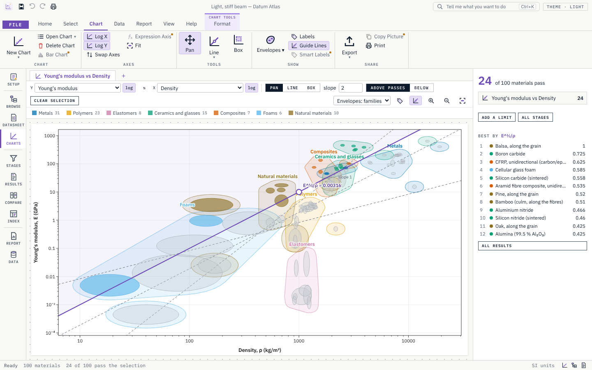
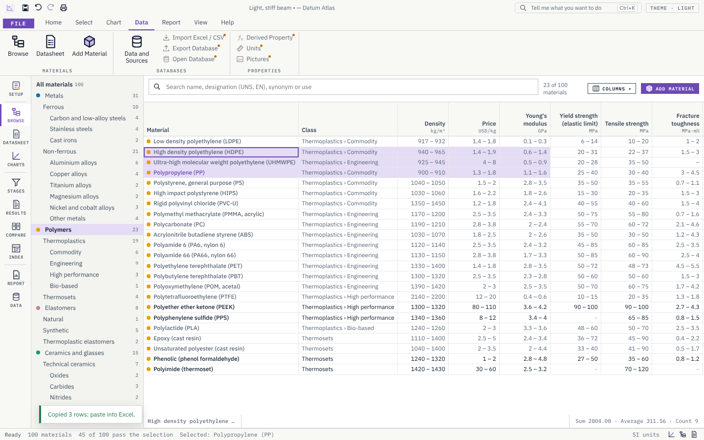
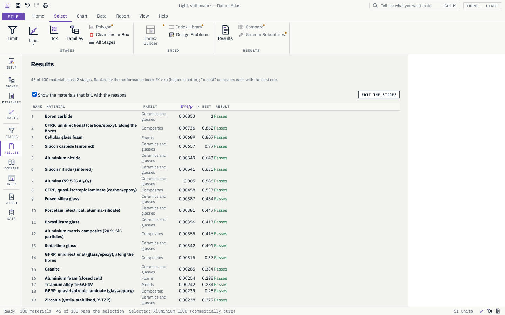
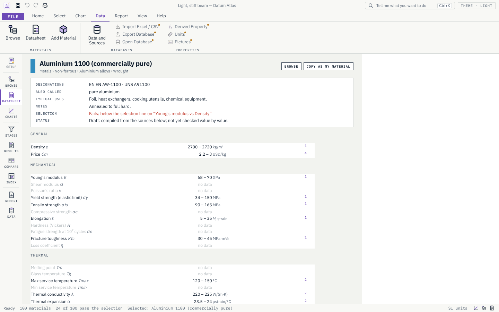
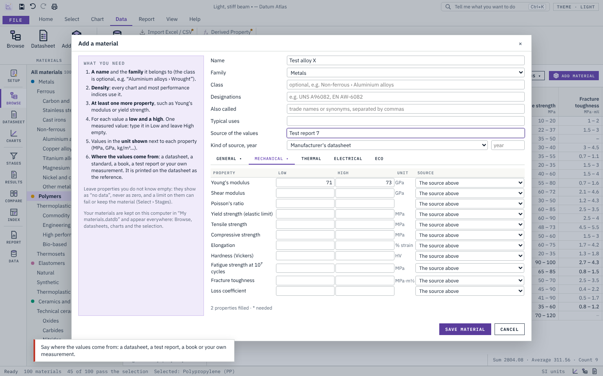

<div align="center">


# Datum Atlas

**Choose the right material: property charts, selection and referenced data, in one app for Windows.**

[](https://github.com/Edgar-Mendonca/Datum-Atlas/releases/latest)
[](https://github.com/Edgar-Mendonca/Datum-Atlas/actions/workflows/ci.yml)
[](https://github.com/Edgar-Mendonca/Datum-Atlas/releases)
[](LICENSE)
[](https://github.com/Edgar-Mendonca/Datum-Atlas/releases/latest)
[](crates/core)
[](https://tauri.app)
[](ui/src)

[](https://github.com/Edgar-Mendonca/Datum-Atlas/releases/latest)
[](CHANGELOG.md)
[](https://github.com/Edgar-Mendonca/Datum-Atlas/issues/new)
[](docs/MEMORY.md)

</div>



## What it does

Datum Atlas helps engineers, designers and students pick a material and show why it is the right one:

1. **Write down the requirements**: what the part does, what it must meet, what to minimise.
2. **See every material on a property chart**: two properties on log axes; each material is a bubble spanning its ranges, each family has its envelope.
3. **Select**: limits (max service temperature ≥ 150 °C, price ≤ 5 USD/kg, recyclable), a **selection line** for a performance index (E^½/ρ for a light, stiff beam is a line of slope 2), a box, or whole families left out.
4. **Rank and check**: the materials that pass, ranked by the index, and the reason every other one fails.

## Features (0.1.0)

- **About 100 materials** from every family: metals, polymers, elastomers, ceramics and glasses, composites, foams and natural materials. **Every value has a reference**, compiled from public sources (U.S. government handbooks, NIST, USGS, the Wood Handbook, open datasets and typical textbook ranges). No proprietary database is used.
- **Your own materials**: the Add Material window explains what is needed (a name, the family, density, at least one more property, low and high values in the unit shown, and where the values come from). They appear in every view.
- **Property charts** of any two properties, log or linear; family envelopes; hover for ranges, click for the datasheet; zoom, pan, guide lines of slope 1, 2 and 3.
- **Selection**: limit, chart (line or box) and family stages; results ranked by the index with “× best”; failures explained.
- **Browse** with a family tree and an Excel-like table (sort, select, copy to Excel), and **datasheets** with grouped properties and numbered references.
- Design problems to start from: light stiff beam, strong tie, stiff panel, springs, hot and light, damage tolerant.
- Print or save as PDF (charts, datasheets, results); export charts as SVG or PNG.
- Light, dark and auto themes; the in-app updater; recovery of unsaved work.

<table><tr>
<td></td>
<td></td>
</tr><tr>
<td></td>
<td></td>
</tr></table>

## Coming next

Units (SI and imperial), search everywhere and several charts per project (0.1.1); the index builder, expression axes and derived properties (0.2); compare, radar charts, the selection report and 250 materials (0.3); your own databases with Excel import (0.3.1); eco audit (0.4); process selection (0.5). See Help › Roadmap in the app, or [docs/MEMORY.md](docs/MEMORY.md).

## Install

Download `DatumAtlas-x.y.z-setup.exe` from the [latest release](https://github.com/Edgar-Mendonca/Datum-Atlas/releases/latest) and run it (per-user install, no administrator rights). Windows SmartScreen may warn on the first install because the installer is not signed yet. Updates install from File › Updates.

## Build

Rust (stable), Node 22, and on Linux the WebKitGTK development libraries.

```
npm ci
npm run build:ui
cargo test --workspace
npx tauri build --bundles nsis
```

The engine (`crates/core`) holds the materials data, units, chart geometry and selection, with unit tests; the window (`ui/src`, SolidJS) only shows what it computes. `npm run test:ui` runs the Playwright tests against the real engine.

## Data

Values are in `data/*.json`, one file per family, with their sources in `data/sources.json`. Each value is `[low, high, source]`. Built-in values are marked “draft” until each one is checked against the exact table or page of its source; corrections with a reference are welcome as issues or pull requests.

## Licence

MIT. See [LICENSE](LICENSE) and [NOTICE](NOTICE).
