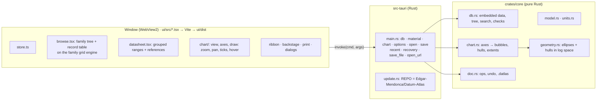

# Datum Atlas: project memory

> **Paste this file at the start of each new session**, or just open the repo: `CLAUDE.md` tells Claude to read it.
> It records what exists, why, and what comes next. Update it at the end of every session.

| | |
| --- | --- |
| **Product** | Datum Atlas: a Windows desktop app for materials selection and property charts (the Ashby method): find the right material, understand why (performance indices, trade-offs), compare candidates, document the decision |
| **Family** | Third Datum app after Datum Plan (`Edgar-Mendonca/Datum-Plan`) and Datum Plot (`Edgar-Mendonca/Datum-Plot`). Design and workflow: [Datum-Plan/docs/FAMILY.md](https://github.com/Edgar-Mendonca/Datum-Plan/blob/HEAD/docs/FAMILY.md). Brief: [Datum-Plan/docs/briefs/DATUM-ATLAS.md](https://github.com/Edgar-Mendonca/Datum-Plan/blob/HEAD/docs/briefs/DATUM-ATLAS.md). Plan's code is the reference implementation: copy, don't reinvent. |
| **Current version** | None yet. Next: **0.1.0** (plan in [PLAN-0.1.md](PLAN-0.1.md), waiting for answers) |
| **Repo** | `Edgar-Mendonca/Datum-Atlas` · working branch `claude/bold-volta-90lu2c` |
| **Identity** | Accent **Violet** (`--blue #6C4AB6`, `--blue2 #5A3C9C`, `--sky #C9B8EE`, `--pale #F0EBFA`, `--sel #E5DCF6`, `--sel2 #CDBDEE`; dark `--blue #A58BEA`, File sidebar dark `#3A2766`) · files `.datlas` (projects), `.datdb` (user databases) · identifier `com.edgarmendonca.datumatlas` · installer `DatumAtlas-x.y.z-setup.exe` · logo `docs/brand/datum-atlas-icon.svg` (violet log–log axes, family bubbles, dotted index line, amber `#F2B233` diamond) |
| **Stack** | Rust engine (`crates/core`) + Rust shell (`src-tauri`), Tauri 2, WebView2, SolidJS + Vite UI in strict TypeScript, plain CSS tokens, IBM Plex. Own SVG chart engine (geometry in Rust). Chart.js later for bar/radar, GridCraft later for expressions. **No Python.** |
| **Code size** | Docs only so far |

---

## 1. Architecture (planned for 0.1.0; see PLAN-0.1 §4)

**Rules:**
- The engine computes every value: ranges, unit conversions, bubbles, hulls, later pass/fail and rankings. The window maps engine geometry to the screen (zoom/pan transform in log space), draws ticks and places labels.
- Every edit is an `Op` applied by the core (undo/redo), as in Plan and Plot.
- The built-in database is JSON in `data/` (one file per family + `sources.json`), embedded at build time and validated by tests. Each value points to a source.
- JSON keys are camelCase between Rust and TypeScript (`serde(rename_all = "camelCase")`), as in Plot.
- Clipboard pictures and clipboard reads go through Rust (WebView2 blocks `navigator.clipboard`; Datum Plot 0.1.0 lesson).

### Files
| Path | What it does |
| --- | --- |
| `CLAUDE.md` | Notes for Claude: read this file first, preferences, checks, release steps. |
| `docs/PLAN-0.1.md` | Brief refined after reading Plan and Plot: identity, reuse, architecture, window, data policy, releases, size, 16 questions. |
| `docs/brand/datum-atlas-icon.svg` | The draft logo (copied from Datum-Plan). |

### Update flow (same as Plan)
On start and on "Check again": GET `/repos/Edgar-Mendonca/Datum-Atlas/releases/latest` (or `/releases` with beta) → badge + Home card with the CHANGELOG section → Update now downloads `DatumAtlas-x.y.z-setup.exe`, checks `SHA256SUMS.txt`, runs it with `/S`, restarts. Install only from this repo's release URLs.

### Release flow (same as Plan)
Bump `src-tauri/Cargo.toml` + `crates/core/Cargo.toml` → CHANGELOG `## x.y.z — date` → update this file → commit + push → `release.yml` (tag push, or workflow_dispatch when tags are blocked) → GitHub Release with setup.exe + SHA256SUMS.txt → users click Update now.

### How we work (from Datum Plan, FAMILY §11)
1. **The user reviews the last release** in the app and sends screenshots with bugs and wishes.
2. **Diagnose first.** Reproduce the problem in the test harness or the real app before changing code. Small fixes go straight to a release.
3. **Bigger asks get a plan file** (`docs/PLAN-x.y.md`): feedback, diagnosis, proposal, size, questions. Logged here and pushed. Build only after the user answers.
4. **Build in small steps**, engine first (`crates/core`, with a unit test), then the UI. Compact code in the surrounding style.
5. **Check in the real app** under Xvfb, with screenshots of each change. Fix what looks wrong.
6. **Add a UI test** for every reported bug and new feature (`tests_ui/run.cjs`). Make it fail on the old code where possible.
7. **Run the checks:** clippy `-D warnings`, `cargo test --workspace` (with the data checks), `npm run check:ui`, `npm run test:ui`.
8. **Release:** bump, CHANGELOG (becomes the in-app "What's new"), update this file, commit, push, run `release.yml`, watch CI + Release, confirm the installer and its size.
9. **Report to the user** in plain language: what changed, what was checked, what is not done, what to check on Windows.

---

## 2. Decisions

| Date | Decision | Why |
| --- | --- | --- |
| 2026-10-24 | Violet accent, `.datlas` + `.datdb`, `com.edgarmendonca.datumatlas`, releases and updater from `Edgar-Mendonca/Datum-Atlas` | The user's instruction, per FAMILY §1 and §3. (Name "Datum Atlas" to confirm, PLAN Q1.) |
| 2026-10-24 | No Python inside the app | The user's instruction and FAMILY §2: install size, start time, a second runtime. |
| 2026-10-24 | Built-in data compiled by us from public sources, a reference for every value; never proprietary databases | The user's instruction and brief §3.5. |
| 2026-10-24 | Plan, memory and questions before any feature code; build 0.1.0 after the answers | The user's instruction and FAMILY §12. |
| 2026-10-24 | Own SVG chart engine; Datum Plot's matplotlib renderer is not reused, but its graph-view patterns are (log/linear mapping, hover, crosshair, double-click zones, docked Format panel, export dialog, Copy Picture through Rust) | Plot draws with Python, which Atlas does not have (PLAN §3). |
| 2026-10-24 (proposed) | Rust computes chart geometry (bubbles, hulls); the window owns the view transform, ticks and labels | Pan and zoom need no engine call per frame; values still come only from the engine. |
| 2026-10-24 (proposed) | Dependencies arrive with the release that needs them: Chart.js (0.3.0 radar/bars), GridCraft (0.2.1 expressions), calamine/rust_xlsxwriter (0.3.x import/export) | Keep 0.1.0 small and quick to build. |
| 2026-10-24 (proposed) | Database as reviewed JSON in `data/`, embedded with `include_str!` and validated by `cargo test`; each value has a `checked` status | Readable diffs for every value and its source; honest drafts that tighten over releases. |

---

## 3. Roadmap

✅ done · 🔜 next · ⬜ planned. Small releases; every one goes through the in-app updater. Details in [PLAN-0.1.md](PLAN-0.1.md) §7.

| Version | Theme | Contents | Status |
| --- | --- | --- | --- |
| — | Plan | CLAUDE.md, this file, PLAN-0.1 with questions | ✅ |
| **0.1.0** | Shell + data + one chart | Shell, updater, File page, family design (Violet), ~60 generic materials with references, Browse, Datasheet, one property chart (log–log bubbles + family hulls, hover, click), Getting Started + Glossary, `.datlas` format 1 | 🔜 |
| 0.1.1 | Units, search, export | SI/imperial, search, datasheet references, export SVG/PNG/PDF, Copy Picture, print (if not in 0.1.0) | ⬜ |
| 0.2.0 | Selection | Limit, chart (box + index line) and tree stages; Results with reasons; projects | ⬜ |
| 0.2.1 | Indices | Index builder (~40 indices); expression axes; derived properties (GridCraft) | ⬜ |
| 0.3.0 | Compare and report | Compare + radar; selection report; ~250 materials | ⬜ |
| 0.3.x | Own data | User databases, Excel/CSV import with mapping; label placement; style presets | ⬜ |
| 0.4 | Eco audit | | ⬜ |
| 0.5 | Process selection | | ⬜ |
| 1.0 | Stable | ~1,000 materials, user guide, signed installer | ⬜ |

---

## 4. Session log

### 2026-10-24: Session 1 (plan)
- The user started Datum Atlas as the third Datum app: Violet accent, `.datlas`/`.datdb`, `com.edgarmendonca.datumatlas`, this repo for releases, no Python, data from public sources with a reference for every value. Asked for CLAUDE.md, this file, `docs/PLAN-0.1.md` and the brief's questions before building.
- Read Datum Plan (read-only): the brief, FAMILY.md, CLAUDE.md, MEMORY.md, CHANGELOG.md, the reference code (styles, icon sprite, ribbon, backstage, print, selection/cells/fmt, update.rs, release and CI workflows, UI tests) and the draft logo.
- Read Datum Plot (read-only): CLAUDE.md, MEMORY.md, PLAN-0.1, `graph.tsx`, `format.tsx`, `print.tsx`, `py/datum/graph.py`. Finding: Plot's graphs are drawn by matplotlib in Python, so only its window-side patterns carry over (PLAN §3).
- Wrote CLAUDE.md, this file and [PLAN-0.1.md](PLAN-0.1.md) (16 questions). Copied the draft logo. No code yet. **Waiting for the answers.**
- Noticed in passing: Datum Plan's CHANGELOG.md has lost the `## x.y.z —` headings of 0.3.7 to 0.3.3 (only " 2026-10-24" remains), so their notes cannot be found by version.

---

## 5. Known limits and next steps

**Next:** the user answers PLAN-0.1 §9; then build and release 0.1.0.

**Open risks:**
- Referencing every value well takes time; 0.1.0 may ship document-level references marked "draft" (PLAN Q7).
- Prices and CO₂ values change and vary by source; they carry a year and basis.
