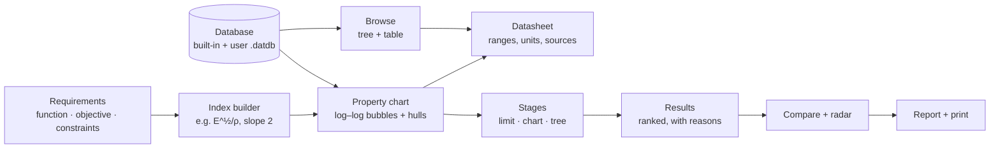
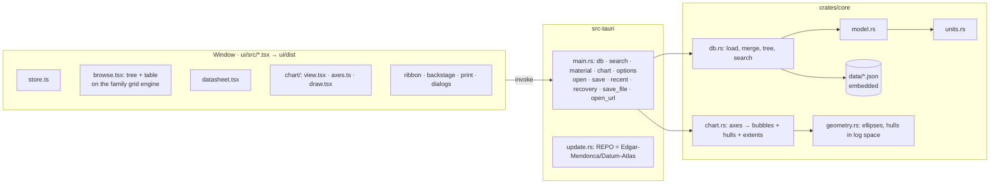

# Datum Atlas 0.1: plan and questions

Status: **waiting for the user's answers** (§9). No feature code yet. Build 0.1.0 after the answers.

**Goal:** a small, fast Windows app for materials selection with property charts (the Ashby method): find the right material for a part, see why it is right, compare candidates and document the decision. Open data with a reference for every value, Excel-style formulas, publication-quality charts.

**Sources:** the brief [Datum-Plan/docs/briefs/DATUM-ATLAS.md](https://github.com/Edgar-Mendonca/Datum-Plan/blob/HEAD/docs/briefs/DATUM-ATLAS.md) (followed; this file refines it), [FAMILY.md](https://github.com/Edgar-Mendonca/Datum-Plan/blob/HEAD/docs/FAMILY.md) (followed exactly), Datum Plan's code (the reference implementation) and Datum Plot's code (checked for reuse, §3).

This file follows the family pattern: brief → what we reuse → proposal → 0.1.0 scope → release plan → size → questions.

---

## 1. Identity

| | |
| --- | --- |
| Name | **Datum Atlas** (to confirm, Q1) |
| Accent | **Violet** (FAMILY §3): `--blue #6C4AB6`, `--blue2 #5A3C9C`, `--sky #C9B8EE`, `--pale #F0EBFA`, `--sel #E5DCF6`, `--sel2 #CDBDEE`; dark `--blue #A58BEA`; File sidebar dark `#3A2766` |
| Logo | Draft `docs/brand/datum-atlas-icon.svg`: the family tile, violet log–log axes, three family bubbles (two `--sky` tint, one violet), a dotted index line, the amber `#F2B233` diamond. Becomes `ui/public/logo.svg` and the Windows icons (`npx tauri icon`). |
| Files | `.datlas` (selection projects), `.datdb` (user databases) |
| Identifier | `com.edgarmendonca.datumatlas` (options, recovery and user databases in its data folder) |
| Repo | `Edgar-Mendonca/Datum-Atlas`: releases and the updater (`REPO` in `update.rs`), installer `DatumAtlas-x.y.z-setup.exe` |
| Python | **None inside the app** (FAMILY §2, brief §5). |

---

## 2. The method in one picture

0.1.0 delivers the top row (database, Browse, Datasheet, one property chart). Stages, the index builder and results come in 0.2.x (§7).

---

## 3. What we reuse

### From Datum Plan (the reference implementation): copy, then rename and recolour
| Part | Reused as |
| --- | --- |
| Workspace `Cargo.toml` (release profile `opt-level s`, LTO, strip), `package.json`, `ui/vite.config.ts`, `ui/tsconfig.json`, `.gitignore`, LICENSE, NOTICE | As is, renamed. |
| `src-tauri`: `main.rs` patterns (state, options, recent files, recovery, `save_file`, `open_url` limited to this repo), `update.rs`, `tauri.conf.json`, capabilities | `REPO = "Edgar-Mendonca/Datum-Atlas"`, user agent `DatumAtlas/x`, `.datlas` file association, identifier. |
| `ui/src/styles.css` | Base tokens unchanged; only the accent set swapped to Violet (light and dark). Chart/canvas colours read tokens. |
| `ui/index.html` icon sprite | The family icons recoloured to violet `--sky` (`#C9B8EE`), plus Atlas icons (§5.4). |
| `ribbon.tsx` | Title bar, QAT, Tell Me (Ctrl+K), theme button, `B`/`G`/`S` buttons, split buttons, contextual tabs, `fitRibbon` (never scrolls, folds groups from the right). |
| `backstage.tsx` | File page: Home (start tiles, recent, updates card with Check again + spinner + time, GitHub/Releases/Report an issue), Options (sections, `Opt` rows), Updates, Print. |
| `print.tsx` | `Frame`, `Slot`, header/footer codes, `PAPERS`, the print page layout (settings left, live preview right), `printNow` with `@page`. |
| `selection.ts`, `cells.ts`, `fmt.ts` | The grid engine for Browse (sort, filter, ranges, Sum/Average/Count, TSV copy). Browse is read-only for the built-in database in 0.1.0, so fill, paste and formatting stay unused until user databases (0.3.x). |
| `ui.tsx`, `store.ts` patterns | Icon, Menu (any depth), Dialog (Enter/Esc), Tabs, form helpers; signals + `call`/`act`/`toast`/theme. |
| `.github/workflows/release.yml`, `ci.yml` | Renamed installer and release name; CI unchanged (clippy, tests, `check:ui`, Playwright). |
| `tests_ui/run.cjs` | Same harness: `ui/dist` served locally, mocked `window.__TAURI__`, a fixture dumped by `cargo run -p datum-atlas-core --example dump`. |

### From Datum Plot: checked, and what fits
Datum Plot draws every graph with **matplotlib in an embedded Python** (`py/datum/graph.py`), and the window shows that SVG. That renderer, the Python worker (`py.rs`) and the runtime pack (`runtime.rs`) **cannot be reused**: Atlas has no Python. So Atlas builds the SVG chart engine the brief allows for (`ui/src/chart/`, geometry in Rust). What does carry over from Plot:

| Plot part | Reused in Atlas |
| --- | --- |
| `graph.tsx` `toData`/`toPt` | The data ↔ screen mapping for linear and log axes, ported to our own SVG (same maths). |
| `graph.tsx` interaction | Crosshair, hover tooltip with values, Ctrl+wheel zoom, double-click hit zones (axis → axis settings, legend → families, data → datasheet), right-click menu (Format, Copy Picture, Export). |
| `graph.py` Prism look | As SVG rules: open or framed axes, ticks out, 1 pt axes, bold axis titles, log axes with decade labels (10², 10³) and minor ticks at 2–9, light optional gridlines. |
| `format.tsx` | The docked Format panel that applies each change at once (with undo), `SIZES` (journal widths in mm), `FONTS`, `OKABE_ITO`. |
| `graph.tsx` `exportGraph` | The Export dialog (format, dpi 150/300/600, transparent), used in 0.1.1. |
| Copy Picture through Rust (`tauri-plugin-clipboard-manager`) | **Lesson from Plot 0.1.0:** WebView2 blocks `navigator.clipboard` on `http://tauri.localhost`. All picture copy and clipboard reads go through Rust from day one. |
| Plot's print page for graphs | Charts print at their real size (mm) or fitted, one per page, with a caption. |
| Other Plot lessons | Dialogs without inputs must still close on Escape (focus fallback); no `.side` class clash between docked panels and the sidebar; fast typing must not lose keys pressed before an edit box has focus; "lay out the whole UI first" with planned commands dimmed (Q10). |

Chart.js (Plan's `charts.tsx`, Prism style) stays the choice for the simple bar and radar charts (0.3.0); it is not needed in 0.1.0, so it is not a dependency yet. GridCraft (formulas) arrives with expressions in 0.2.1, `calamine`/`rust_xlsxwriter` with import in 0.3.x: each dependency comes with the release that needs it.

---

## 4. Architecture

| Layer | Choice |
| --- | --- |
| Shell | Rust + Tauri 2 (`src-tauri`), Windows first (NSIS per-user, WebView2) |
| Engine | `crates/core` = crate `datum-atlas-core`: pure Rust, unit-tested, all calculation |
| Window | SolidJS + Vite + strict TS (`ui/src`), family CSS tokens with the Violet accent |
| Charts | Our own SVG engine: **Rust computes the geometry** (bubbles and hulls in log space, later selection lines and pass/fail); **the window owns the view** (zoom/pan transform, ticks, labels, hover) |
| Data | Source JSON files in `data/` (one per family, reviewed in git), embedded with `include_str!` and checked by tests at build time |
| Tests | Rust unit tests; Playwright UI tests |

### Engine modules (brief §5, refined)
| File | 0.1.0 contents |
| --- | --- |
| `model.rs` | `Material` (id, name, `family` path, synonyms, designations, `props`, notes, uses, `refs`), `PropValue` (`Range { lo, hi, typical, src }`, `Rating`, `Flag`, `Text`), `Property` (key, name, symbol, group, unit kind, log default, description), `Source` (id, title, publisher, year, url, licence, kind), `Database`, `Project` format 1 (charts, notes, `ui`). |
| `units.rs` | Unit kinds with one stored SI unit each (§6.2); formatting with significant figures; the imperial set comes in 0.1.1 but the conversion table and its round-trip test land now. |
| `db.rs` | Embedded database: parse, validate (the data checks of §8), family tree with counts, lookup by id, plain search by name/synonym/designation (full search UI in 0.1.1). |
| `geometry.rs` | Bubble = axis-aligned ellipse in log space spanning lo–hi on each axis (minimum size when lo = hi); family hull = convex hull of sampled bubble outlines, then smoothed (rounded offset) so it encloses every bubble; linear axes use the same code without the log. |
| `chart.rs` | `ChartReq { x, y, log_x, log_y, hull_level }` → `ChartOut { bubbles, hulls, extents, missing }`: materials missing a value are listed, never drawn at zero. |
| `doc.rs` | `Op` (chart axes, scale, style, notes), undo/redo, `.datlas` read/write with a format number (as Plan and Plot). |

Later (per the brief): `expr.rs` (0.2.1), `select.rs` (0.2.0), `index.rs` (0.2.1), `io.rs` (0.3.x), `report.rs` (0.3.0).

**Rule:** the window never calculates material values, ranges, hulls or pass/fail. It only maps engine geometry to the screen (an affine transform in log space), draws ticks and places labels. This matches Plan's rule and Plot's graph view, and lets pan and zoom run at full speed without a call per frame.

---

## 5. Proposal for the window

### 5.1 Layout (family)
- **Title bar:** QAT (save, undo, redo, print), document name, Tell Me (Ctrl+K), Theme (Auto/Light/Dark).
- **Ribbon tabs** (brief §4): **Home** (clipboard, find, new chart, units), **Select**, **Chart**, **Data**, **Report**, **View**, **Help**; contextual **Chart Tools › Format** while a chart is open. "Home" is the brief's word for Atlas; Plan dropped a Home tab because it was crowded and MSP-like, which does not apply here (to confirm, Q11).
- **Left sidebar:** Setup · Browse · Datasheet · Charts | Stages · Results · Compare · Index builder | Report · Data.
- **Main area:** the chart canvas on Plan's dotted whiteboard background (white when printed or exported); the stage panel on the right arrives with stages in 0.2.0.
- **Status bar:** Ready · materials shown / total · the database · the units · zoom.
- **File page, Options, Print, updater, themes:** as in Plan.

### 5.2 Browse
- Left: the family tree (Metals › Non-ferrous › Aluminium alloys …) with counts; clicking a node filters the table.
- Right: the record table on the family grid engine: name, family, and chosen property columns (density, E, σy, K_IC, λ, price…) shown as `lo – hi` with units in the heading; sort by clicking a heading (by the geometric mean of the range), ranges with Sum/Average/Count, Ctrl+C copies TSV for Excel.
- Double-click a row → Datasheet.

### 5.3 Datasheet
- Header: name, family path, designations (EN, UNS, ASTM, ISO, JIS), synonyms.
- Grouped properties (General, Mechanical, Thermal, Electrical, Optical, Durability, Processing, Eco): a row per property with `lo – hi`, the typical value when present, the unit, and a superscript reference number; missing values show "–" with "no data", never zero.
- References list at the bottom (title, publisher, year, link, licence). Notes and typical uses.

### 5.4 Property chart (the heart)
- Defaults to **Young's modulus vs density**, log–log; X and Y pickers list every range property; Linear/Log per axis.
- **Bubbles:** an ellipse per material spanning its ranges, filled with its family colour at about 35 % opacity with a 1 px edge. **Hulls:** one per family, smoothed, about 12 % opacity, labelled with the family name.
- **Hover:** tooltip with the name, family and both ranges with units; the bubble's edge thickens. **Click:** opens the Datasheet. **Double-click** an axis: axis settings.
- Zoom (Ctrl+wheel, zoom box, buttons), pan (drag the background), Fit; decade ticks 10⁻¹, 10⁰, 10¹ … with minor ticks at 2–9 and optional light gridlines.
- Guide lines for slopes 1, 2, 3 (E/ρ, E^½/ρ, E^⅓/ρ) can be switched on in 0.1.0 as plain guides; draggable index lines and pass/fail come with stages in 0.2.0.
- Family legend (click a family to show or hide it).
- **Family colours** (Okabe-Ito, colour-blind safe, to approve, Q12): Metals `#0072B2` blue · Polymers `#E69F00` orange · Elastomers `#CC79A7` pink · Ceramics and glasses `#009E73` green · Composites `#D55E00` vermilion · Foams `#56B4E9` sky · Natural materials `#8C6D1F` brown (Okabe-Ito yellow is too pale for edges on white).
- New icons in the sprite: `i-atlas` (chart), `i-bubble`, `i-hull`, `i-index` (slope line), `i-datasheet`, `i-tree`, `i-stage`, `i-results`, `i-compare`, `i-radar`, `i-units`, `i-material`, `i-db`.

### 5.5 Help
Getting Started for newcomers to the Ashby method (what a property chart is, why log axes, what a bubble and a hull are, how an index line selects), a searchable Glossary (bubble, hull, family, class, performance index, selection line, limit stage, range, typical value, log decade…), Shortcuts, Tell Me, GitHub links.

---

## 6. Data

### 6.1 Policy (brief §3.5)
- Every value is **compiled by us** with a reference: `src` points to a record in `data/sources.json` (title, publisher or author, year, edition, URL, licence, kind: `handbook`, `government`, `open-dataset`, `datasheet`, `textbook-typical`, `computed`).
- **Allowed:** public-domain US government handbooks and data (MIL-HDBK-5J, MIL-HDBK-17, NIST, USGS Mineral Commodity Summaries for metal prices), open datasets with a compatible licence, named per record (Materials Project, CC-BY 4.0, only for computed properties and marked as computed), manufacturer datasheets (cited with the product and date), and textbook-level typical ranges rewritten as our own compilation and cited.
- **Never** Granta/CES, MatWeb, Total Materia, ASM or any other proprietary database, and no product names or wording from them in the app.
- Each record carries a `checked` status (`draft` → `checked`), so we can ship honest drafts and tighten references over releases. The Datasheet shows a "draft value" mark until it is checked (Q7).
- Prices and CO₂ carry their year and basis (e.g. USD/kg, 2025, bulk) because they change.

### 6.2 Stored units (SI, one per kind)
density kg/m³ · modulus GPa · strength MPa · toughness MPa·m½ · hardness HV · temperature °C (shown in °C or K, °F in imperial) · conductivity W/(m·K) · expansion µstrain/°C (10⁻⁶/°C) · specific heat J/(kg·K) · resistivity µΩ·cm · price USD/kg · embodied energy MJ/kg · CO₂ kg/kg · loss coefficient (–) · elongation % strain.

### 6.3 0.1.0 database: ~60 generic materials, every family
| Family | Classes | About |
| --- | --- | --- |
| Metals | Carbon and low-alloy steels, stainless steels, cast irons, aluminium alloys (cast, wrought), copper alloys, titanium alloys, magnesium alloys, nickel alloys, zinc alloys, lead, tungsten | 18 |
| Polymers | Thermoplastics (PE, PP, PS, PVC, PMMA, PC, ABS, PA, PET, PEEK, PTFE, POM), thermosets (epoxy, polyester, phenolic) | 15 |
| Elastomers | Natural rubber, butyl, neoprene, silicone, EVA, polyurethane | 5 |
| Ceramics and glasses | Alumina, silicon carbide, silicon nitride, zirconia, boron carbide, tungsten carbide, soda-lime glass, borosilicate glass, silica glass, concrete, brick, stone | 12 |
| Composites | CFRP, GFRP, aluminium/SiC MMC | 3 |
| Foams | Flexible and rigid polymer foams, metal foam | 3 |
| Natural materials | Wood (along and across the grain), bamboo, cork, leather | 5 |

0.1.0 properties (enough for the classic charts): density, price, Young's modulus, yield strength, tensile strength, fracture toughness, max service temperature, thermal conductivity, thermal expansion, CO₂ footprint. The other ~30 starter properties of the brief are defined in the property list now and filled as data grows (0.3.0: ~250 materials with references).

---

## 7. Releases (brief §7, refined)

| Version | Contents |
| --- | --- |
| **0.1.0** | Shell, updater, File page with Home/Options/Updates, family design with Violet, logo and icons; ribbon and sidebar; ~60 generic materials (all families, 10 properties, every value referenced); **Browse** (tree + table); **Datasheet** (groups, ranges, references); **one property chart** (log–log bubbles + smoothed family hulls, hover, click → datasheet, zoom/pan/fit, slope guides, family legend); Getting Started + Glossary; `.datlas` format 1 (charts and notes); recovery; Print of the chart and datasheet (Q9) |
| 0.1.1 | Units (SI / imperial, per-property choice); search (name, synonym, designation, keywords); chart export SVG / PNG 300–600 dpi / PDF and Copy Picture through Rust; several charts per project |
| 0.2.0 | Selection: limit, chart (box + draggable index line) and tree stages; Results with reasons ("Failed: max service temperature 120 °C < 150 °C"); stage panel; failed materials greyed on every chart |
| 0.2.1 | Index builder (~40 indices with derivations); expression axes (`[Young's modulus]^0.5/[Density]`); derived properties (GridCraft) |
| 0.3.0 | Compare (2–6) with radar charts; the selection report; ~250 materials with references |
| 0.3.x | User databases (`.datdb`), Excel/CSV import with mapping and export; label collision avoidance with leader lines; style presets (publication, classic, monochrome); polygon stage |
| 0.4 | Eco audit · 0.5 Process selection · 1.0 ~1,000 materials, user guide, signed installer |

---

## 8. Size and quality

**Size (0.1.0):** core ~1,400 lines (+ ~60 records of data JSON, ~25 sources), shell ~450 (most copied), UI ~2,600 TSX/TS + CSS (half copied from Plan), UI tests ~150. Installer expected about 2 MB (Plan 0.1.0 was 1.7 MB; the database adds tens of kB).

**Engine tests:** unit round-trips (for 0.1.1's imperial set too); range maths in log space (geometric mean, decade span); every bubble lies inside its family hull for the default and several other axis pairs; missing values are excluded from charts and listed; the database checks (every value has a source that exists, lo ≤ hi, positive values where a log axis is possible, units consistent with the property, no duplicate ids or designations); `.datlas` round-trip.

**UI tests:** the chart renders a bubble per material with both values and a hull per family; hover shows the ranges; click opens the datasheet; Browse tree filters the table and Ctrl+C gives TSV; the ribbon fits at 1280 and 1600 px; every view prints; Options lines up; no script errors.

**Checked in the real app** under Xvfb with screenshots before release.

---

## 9. Questions

From the brief (§9):
1. **Name:** Datum Atlas, or another from the list (Matter, Select, Alloy, Element)?
2. **Users first:** students and teaching (simpler, more explanation) or practising engineers (more grades and designations)? *Proposal: engineers first in the data (designations, real grades from 0.3.0), with the explanations of Getting Started and the Glossary for both.*
3. **Database:** start with ~60 generic families and common grades, then add specific grades later? *Proposal: yes, as in §6.3.*
4. **Must-have properties** beyond the starter set (corrosion in specific media, biocompatibility, RoHS/REACH, food contact, others)?
5. **Eco audit and process selection:** needed early, or after 1.0? *Proposal: CO₂ footprint and embodied energy as plain properties now; the eco audit (0.4) and process selection (0.5) before 1.0 as in the brief.*
6. **Earlier attempts** at this app (repos or files) to reuse or learn from?

My own:

7. **References:** for the 0.1.0 drafts, is a reference to the document (e.g. "MIL-HDBK-5J, aluminium alloys chapter") with a visible "draft" mark acceptable, tightening to the table or page by 0.3.0? Or do you want table/page-level references from the first value?
8. **Sources:** OK to use MIL-HDBK-5J/-17, NIST, USGS (prices), the Materials Project (CC-BY 4.0, computed values only), manufacturer datasheets and our own compilation of textbook-typical ranges? Any source you want excluded or added (e.g. a university course's open data)? Wikipedia only to find primary sources, never as the source (its CC BY-SA licence does not fit an MIT database).
9. **Print in 0.1.0:** the brief puts print in 0.1.1, but the family rule is that every view prints. The chart is already SVG, so printing it and the datasheet is small. Bring it into 0.1.0? *Proposal: yes; exports and Copy Picture stay in 0.1.1.*
10. **Lay out the whole UI first** (as Datum Plot 0.1.1 did): every planned command already in the ribbon and sidebar, dimmed, with a card saying what it will do and when? Or only show what works, with honest empty states? *Proposal: lay it out, so you can judge the whole workflow from 0.1.0.*
11. **Ribbon:** keep the brief's tabs, including **Home**, or rename it (e.g. "Atlas") as Plan did not use "Home"?
12. **Family colours:** approve the Okabe-Ito mapping in §5.4 (Metals blue, Polymers orange, Elastomers pink, Ceramics green, Composites vermilion, Foams sky, Natural brown)? Elastomers and foams get their own hulls even though they sit under Polymers in the tree.
13. **Default chart look:** the "Classic" look (filled family bubbles and hulls on the whiteboard) for the screen, with the Prism-like publication look one click away (0.3.x presets)? Or publication first?
14. **Temperatures** shown in °C by default (K and °F available)? Prices in USD/kg with the year, or another currency first?
15. **Logo:** keep the draft as is, or adjust (e.g. thicker index line, a third tint bubble)?
16. **Release:** release 0.1.0 straight after building and checking, as Plan and Plot did?
