# Datum Atlas Guide

## Welcome

Datum Atlas is a materials workbench: modules that share one library of referenced materials. Today they are **Library**, **Select**, **Eco**, **Make**, **Microstructure** and **Crystal**; Testing, image analysis, EBSD, DIC, corrosion and heat treatment are on the way.

The Select module helps you choose a material and show why it is the right one. Every material is drawn on property charts as a bubble spanning its range of values; design goals and performance indices turn what the part must do into a line on the chart; limits, lines, boxes and shapes narrow the field; and the materials that pass are ranked, with the reason every other one fails. Then you compare the best, add up their energy and CO₂ through the product's life, find the processes that can make the part and what it costs, and print a report that documents the choice.

This guide takes you through Datum Atlas step by step. Each chapter stands on its own.

How to read this guide:

- Names in **bold** are buttons, tabs and boxes exactly as they appear in Datum Atlas.
- An arrow › is a path: **Select › Design Goal** means the **Select** tab, then the **Design Goal** button.
- Keys are shown like this: [[Ctrl+K]].
- The orange numbers on the pictures match the numbered lists under them.

> **Tip.** Almost every tool has a small **?** beside it. Click it for a card that says what the tool does and how to use it. **Help › What Is This Tool?** lists them all.

### About the data

Every value in Datum Atlas is compiled from open and public sources: government handbooks, open datasets, university notes, producers' own datasheets and typical textbook ranges. Each value names its source, and a ✓ marks values checked against a published datasheet; the others are drafts. A value that is not known is a gap, never a zero. The values describe generic materials: before you decide, check the supplier's data for the grade and condition you will use.

## Install, update and start

### Install

1. Download `DatumAtlas-x.y.z-setup.exe` from the Releases page: github.com/Edgar-Mendonca/Datum-Atlas/releases.
2. Run it. It installs for your own Windows account, so you do not need administrator rights.
3. The first time, Windows may show **Windows protected your PC**, because the installer is not code-signed yet. Click **More info**, then **Run anyway**.

### Updates

Datum Atlas checks for a new version when it starts. When one is ready, **File › Updates** shows it; click **Update now**. The download is checked against its checksum before it installs, and your projects and materials are not touched.

### The Home page

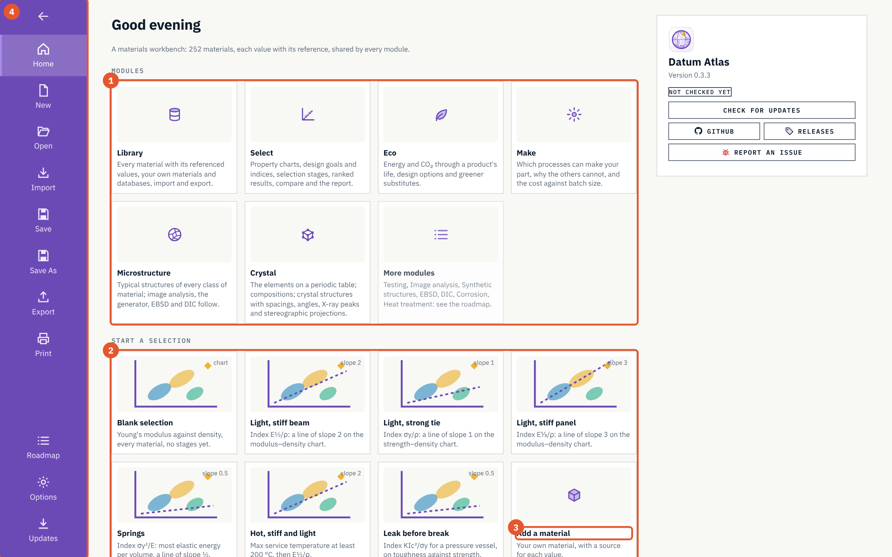

1. **Modules.** A tile per module opens it; **More modules** shows the ones on the way in the roadmap.
2. **Start a selection.** Each design problem starts a project set up for a classic design: a light, stiff beam; a light, strong tie; a stiff panel; springs; a hot, stiff and light part; leak before break. **Blank selection** starts with one chart and nothing selected.
3. **Add a material**, the **Guide** and **Open** are here too.
4. **The File page** also has **New**, **Open**, **Import**, **Save**, **Save As**, **Export**, **Print**, **Roadmap**, **Options** and **Updates**. The arrow at the top goes back to your project.

Projects are saved as `.datlas` files. Your own materials live in a database of their own (`.datdb`), so every project sees them.

## The window at a glance

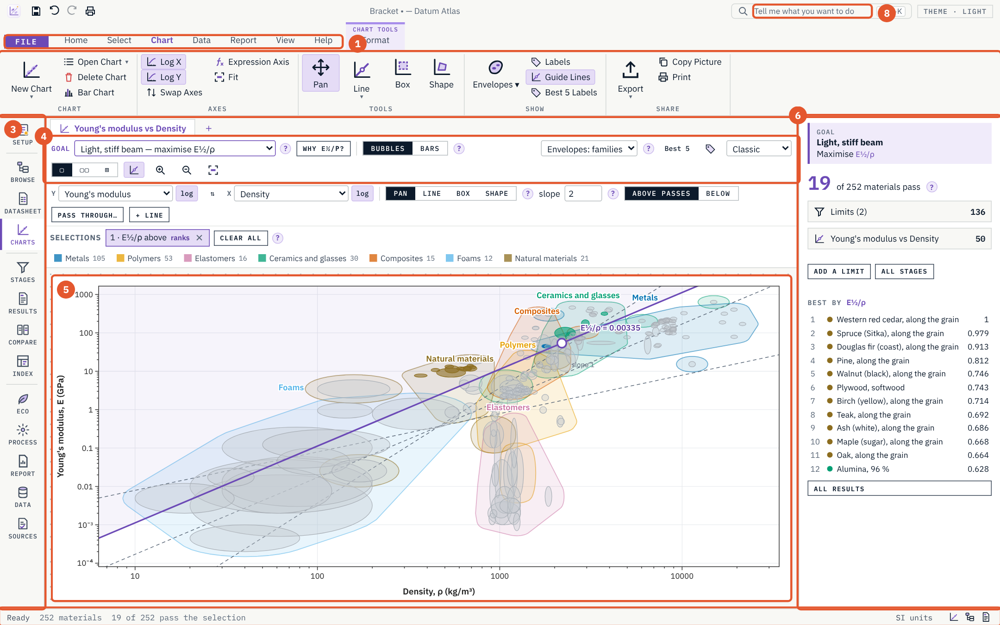

1. **File and the ribbon tabs:** **Home**, **Select**, **Chart**, **Data**, **Report**, **View** and **Help**. **Chart Tools › Format** appears while a chart is open.
2. **The ribbon.** The buttons of the chosen tab, in named groups.
3. **The sidebar.** At the top, the open module (click it to switch); below, its pages: here the Select module's Setup, Charts, Stages, Results, Compare, Index and Report.
4. **The chart bar.** The design goal, bubbles or bars, envelopes, the five best labelled, the chart style, the axes and the chart tools.
5. **The property chart.** Every material as a bubble; hover for its values, click to pick it, double-click for its datasheet.
6. **The stage panel.** How many materials pass, each stage with its count, and the best materials by the ranking.
7. **The status bar.** The number of materials, how many pass, the material picked, and **SI units** or **Imperial units** (click to switch).
8. **Tell Me** ([[Ctrl+K]]). Type what you want to do, a design goal or a material, and press [[Enter]].

The ribbon at a glance:

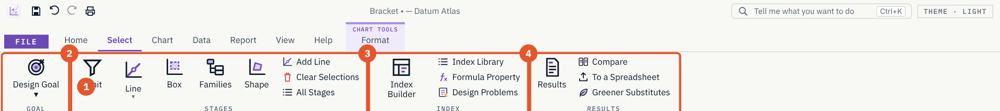

1. **Goal:** pick a design goal for the open chart.
2. **Stages:** add a limit, a selection line, a box, a shape, leave families out; add a second line; clear the selections; see all stages.
3. **Index:** the index builder and library, your own formula properties, the design problems.
4. **Results:** the ranked results, Compare, results to a spreadsheet, greener substitutes.

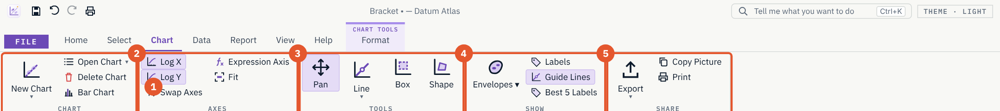

1. **Chart:** a new chart, open or delete one, a bar chart of one property.
2. **Axes:** log or linear scales, swap the axes, an expression axis (a formula), fit to the data.
3. **Tools:** what a drag on the chart does: pan, draw a line, a box or a shape.
4. **Show:** envelopes, labels, guide lines, the best five labelled.
5. **Share:** export the chart as a picture (SVG or PNG), copy it, print it.

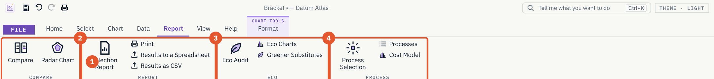

1. **Compare** and the radar chart.
2. **Report:** the selection report, print, the results as a spreadsheet or CSV.
3. **Eco:** the eco audit, its charts and greener substitutes.
4. **Process:** process selection, the process records and the cost model.

## Modules

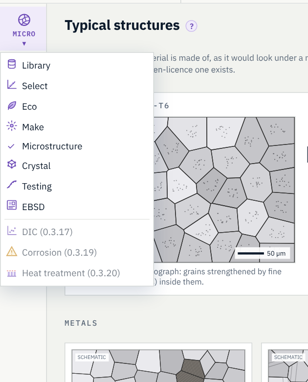

Click the module at the top of the sidebar to switch. Each module shows its own pages in the sidebar and its own tabs on the ribbon; **File**, **View** and **Help** are always there. One project file holds the work of every module.

| Module | Pages | What it is for |
| --- | --- | --- |
| **Library** | Browse, Datasheet, Data, Sources | Every material with its referenced values; your own materials and databases; import and export |
| **Select** | Setup, Charts, Stages, Results, Compare, Index, Report | Choosing a material: charts, goals and indices, stages, ranking, compare, the report |
| **Eco** | Eco audit | Energy and CO₂ through a product's life; greener substitutes |
| **Make** | Process, Processes | Which processes can make the part, and the cost |
| **Microstructure** | Structures | The typical structure of every class of material |
| **Crystal** | Elements, Lattice | The elements on a periodic table; compositions; crystal structures, spacings, angles, X-ray peaks and stereographic projections |

The dimmed modules in the list are on the way; click one to see what it will do and when.

## The method in five steps

Datum Atlas follows the method engineers learn for choosing materials:

1. **Write down what the part must do.** Its *function* (carry a load in bending, hold pressure, conduct heat), its *constraints* (stiffness, strength, 150 °C, cost), its *objective* (minimise mass, cost or CO₂) and its *free variables* (what you may change: thickness, section, the material). **Setup** has a box for this.
2. **Look at the materials on a property chart.** Two properties on log axes. Each family has an envelope.
3. **Select.** Limits remove what cannot work; a selection line keeps the materials that do the job best.
4. **Rank and check.** Results lists what passes, ranked by the index, and why each other material fails. Open the datasheets of the best few and check their references.
5. **Check its life and how to make it.** The eco audit and process selection.

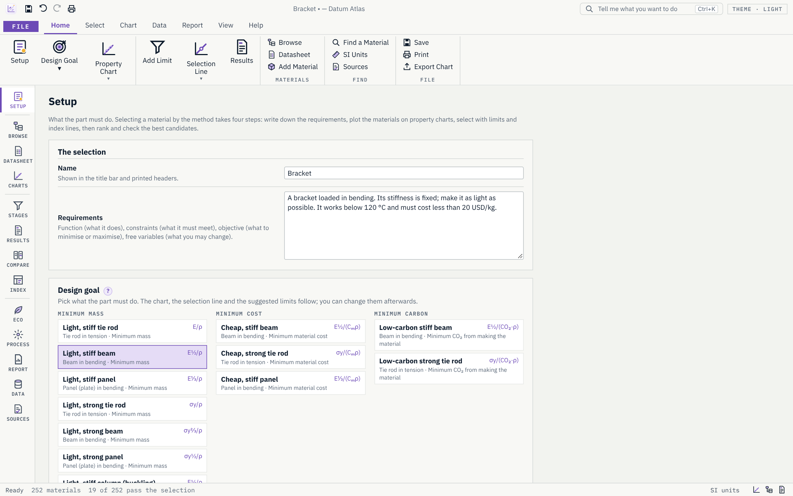

## Property charts

A property chart puts every material on two properties: here Young's modulus against density. Each material is an ellipse spanning its range of both values, so a material whose stiffness varies with grade is a tall bubble. Each family (metals, polymers, elastomers, ceramics and glasses, composites, foams, natural materials) has a coloured envelope around its members. Log axes fit materials that differ a thousand times on one chart.

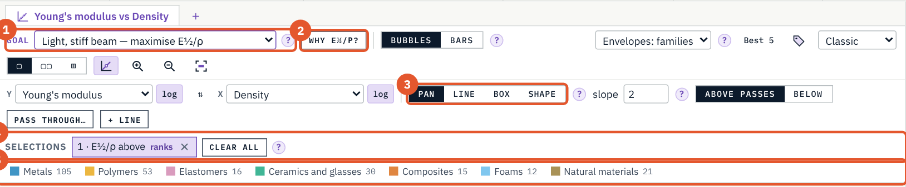

1. **Design goal.** Sets up the chart for a goal (next chapter).
2. **Why E½/ρ?** Explains the goal's index.
3. **Pan, Line, Box, Shape.** What a drag on the chart does.
4. **Selections.** The lines, boxes and shapes on this chart, as chips: click one to edit it, × to remove it.
5. **The legend.** Click a family to hide or show it on this chart.

Working on the chart:

- **Hover** a bubble for its values; **click** to pick it (its datasheet shows beside the chart); **double-click** for the full datasheet.
- **Wheel** to zoom around the mouse; drag to pan with **Pan**; **Fit** shows everything.
- **Y** and **X** choose the properties; **log** switches each scale. **Expression Axis** plots a formula, such as `[E]^0.5/[rho]`.
- **Bars** draws one property for every material as a bar from its low to its high value, grouped by family.
- **Guide lines** of slope 1, 2 and 3 show the directions of the classic indices.
- **+** beside the chart tabs adds a chart. The ▢, ▢▢ and ⊞ buttons in the chart bar show one, two or four charts at once, and the material under the mouse is lit on all of them.
- **Chart style:** classic colours, publication (finer lines) or monochrome (greys, for black-and-white print).

> **Tip.** **Labels** names every material; **Best 5** names only the five best by the ranking. Labels move apart so they do not overlap; drag one to place it, and a leader line follows.

## Design goals and performance indices

A **design goal** turns what the part must do into a line on a chart. Pick **Light, stiff beam** and Datum Atlas puts Young's modulus against density, draws a selection line of slope 2 through the best materials (the top fifth pass), adds the limits the goal needs (marked **from the goal**) and ranks the results by its index, E½/ρ.

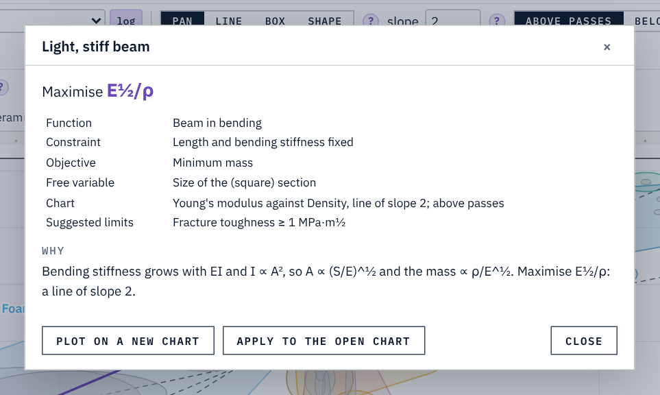

The **index** follows from the design. A beam of fixed length and bending stiffness, made as light as possible, with its section free: its stiffness grows with E·I and I with the square of the area, so the mass falls as ρ/E½. The lightest beam has the highest E½/ρ: on log axes, a line of slope 2. A tie gives E/ρ (slope 1); a panel gives E⅓/ρ (slope 3).

There are 25 design goals, grouped: minimum mass, minimum cost, minimum carbon, elastic design, damage tolerance, thermal, and two constraints (stiff **and** strong, which set up two charts). **Explore** removes the goal's line and limits; your own limits are never touched.

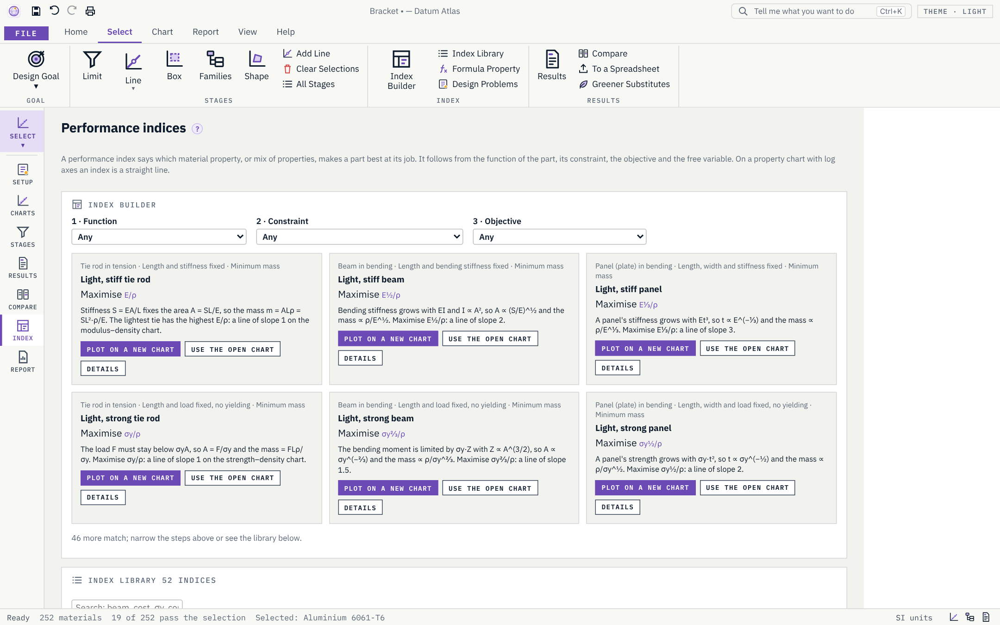

The **Index** page has 52 indices. The **Index builder** narrows them in three steps: the **function** (tie, beam, panel, column, shaft, spring, pressure vessel…), the **constraint** and the **objective**. Each card gives the index and how it follows; **Plot on a new chart** keeps the open chart, **Use the open chart** applies it there.

### Your own formula properties

**Data › Formula Property** defines a property of your own from others, for example `[sy]^2/[E]` for a spring or `[E]*[alpha]` for thermal stress. It is worked out for every material, with its range (low with low, high with high), and works like any other property on charts, in limits and in the ranking. A material without one of the values gets a gap, never a zero.

## Selecting

A material passes when it passes **every stage**.

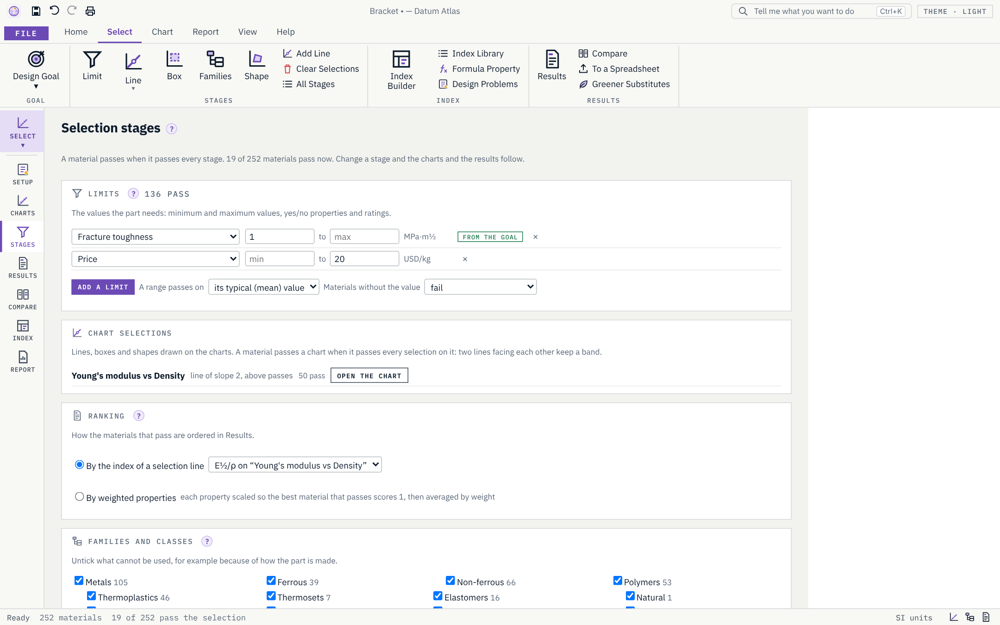

### Limits

**Add a limit**, choose a property and type a minimum, a maximum or both, in the units shown. A yes/no property (recyclable, combustible…) is a tick; a rating (fresh water, weak acids, UV light, fire resistance, castability, machinability, weldability) takes the lowest rating that will do.

- **A range passes on** its typical (mean) value, or only if the **whole range** passes.
- **Materials without the value** fail, or pass marked **no data**.

### Selections on a chart

- **A line** keeps the materials above it (or below). Type its **slope**, or let a goal set it; drag its round handle, nudge it with the arrow keys, or **Pass through…** a value of the index. [[Delete]] removes the active selection.
- **+ Line** adds a second line. Two lines of the same slope facing each other keep a **band**.
- **Box** keeps a window of values on both properties; **Shape** draws any outline: click the corners, then click the first corner, double-click or press [[Enter]] to close it.

### Families

Untick the families and classes that cannot be used: no polymers in a hot part, no wood where it gets wet.

### Ranking

The materials that pass are ranked **by the index of a selection line**, or **by weighted properties**: choose properties, whether higher or lower is better, and a weight for each; each property is scaled so the best material that passes scores 1.

## Results

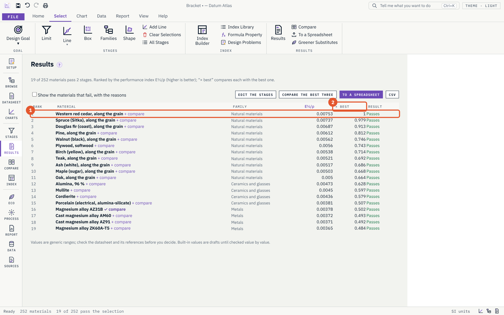

1. **The materials that pass**, ranked, with their index value.
2. **× best**: each material's index divided by the best material's: 1 for the best, 0.5 for half as good.

Below them, every material that fails says why: *below the selection line on "Young's modulus vs Density"*, *price above 20 USD/kg*, *no data for max service temperature*. **+ compare** adds a material to Compare. **Select › To a Spreadsheet** saves the whole table (rank, index, × best, the values the selection uses, the reasons) as `.xlsx`; **Report › Results as CSV** as `.csv`.

## Browse, datasheets and sources

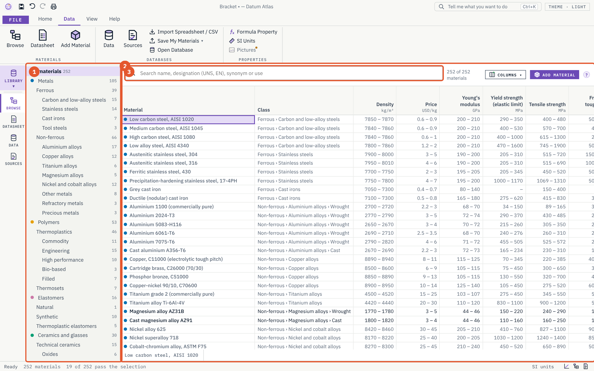

1. **The family tree.** Click a family or class to show only its materials.
2. **Search** by name, designation (UNS, EN, JIS, ASTM), family or use.
3. **The table.** Sort by any heading; choose the columns; select cells, rows or columns and copy them ([[Ctrl+C]]) into a spreadsheet. [[Enter]] opens the datasheet.

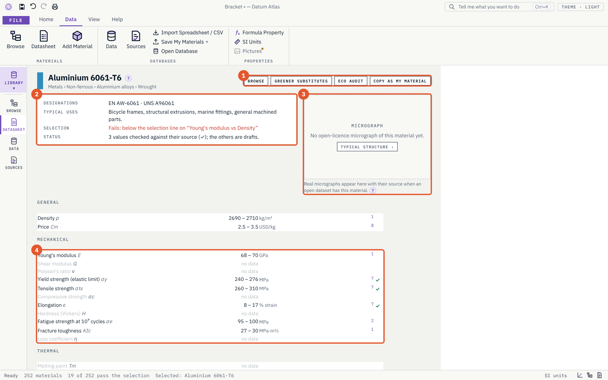

1. **Greener substitutes**, **Eco audit** (adds it to the audit) and **Copy as my material**.
2. **The facts:** designations, other names, typical uses, notes, how it fares in the selection, and its status (draft, or how many values were checked).
3. **The micrograph:** a real micrograph of the material with its source, when an open-licence one exists (none yet: the box says so). **Typical structure** opens the Microstructure module on the material.
4. **The values**, grouped (general, mechanical, thermal, electrical, durability, processing, eco, derived), each with its unit and the number of its reference; ✓ marks a checked value; *no data* is a gap.

The references at the bottom give each source: its title, publisher, year, licence and link. The **Sources** page lists every source, its kind and licence; click one to see which materials and values cite it.

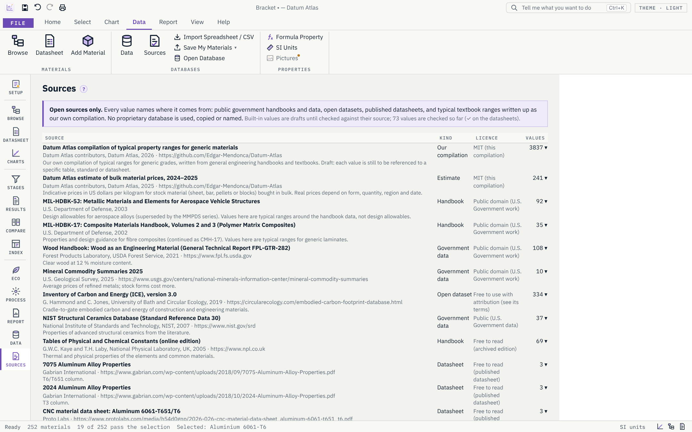

## Microstructure: typical structures

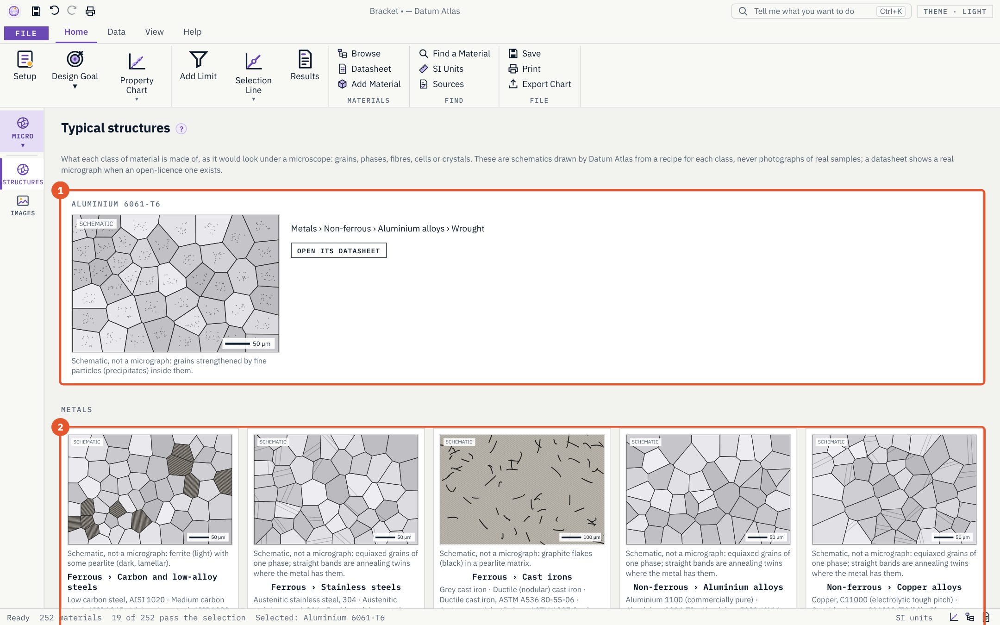

The **Structures** page shows what each class of material is made of, as it would look under a microscope: grains (with twins in copper, nickel and stainless steels), ferrite and pearlite, martensite, graphite in cast irons, dendrites in castings, α + β colonies in titanium alloys, precipitates in age-hardened alloys, sintered ceramics, glass, fibres and plies, foam cells, wood, cork, spherulites in semicrystalline polymers, and more. Each has a scale bar and a caption.

These are **schematics** drawn by Datum Atlas from a recipe for each class, never photographs of real samples. Opened from a datasheet, the page starts with that material's own drawing. The command line draws one too: `datum-atlas-cli microstructure ID`.

Image analysis of your own micrographs, a structure generator, EBSD and DIC will join this module.

## Crystal: the elements

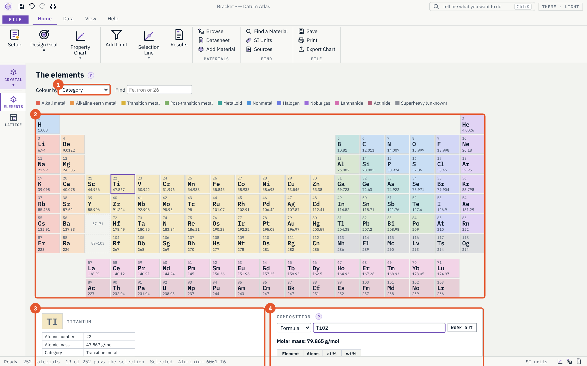

1. **Colour by:** colour the table by category, or by density, melting point, electronegativity or atomic mass to see how a property runs across it (pale is low, deep is high).
2. **The table:** click an element, or type its symbol, name or number in **Find** and press Enter.
3. **The element card:** atomic mass, category, group and period, state, density, melting and boiling points, crystal structure, lattice parameters and electronegativity, with their sources. A value nobody knows reliably, as for most of the heaviest elements, is left blank and the table hatches it; it is never shown as zero. **In the library** lists the materials built on the element.
4. **Composition:** the molar mass and each element's atom and weight percent of a formula (Fe2O3, Al2(SO4)3, CuSO4·5H2O), or the change between weight and atom percent for an alloy: write each element and its percent, and leave one without a number as the balance (Al Cu 4.4 Mg 1.5 Mn 0.6).

The command line does the same: `datum-atlas-cli element Fe` and `datum-atlas-cli composition --wt Fe C 0.8`. **Its crystal, X-ray peaks and projection** on the card of a metal or semiconductor opens it in the Lattice page.

## Crystal: lattice calculators

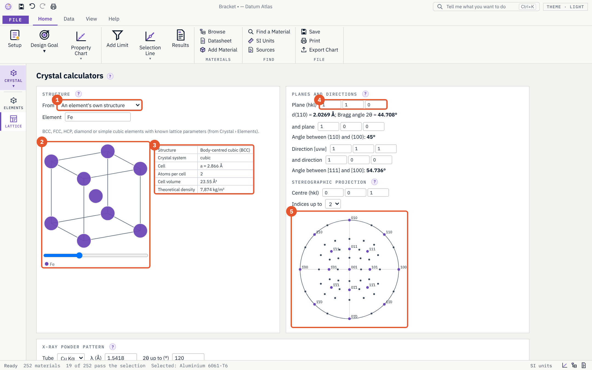

1. **From:** an element's own structure (BCC iron, FCC aluminium, HCP magnesium, diamond silicon…), a structure type (simple cubic, BCC, FCC, HCP, diamond, rock salt, caesium chloride, zinc blende, fluorite) with its lattice parameter and elements, or **Any cell** with all six lattice parameters for tetragonal, orthorhombic, monoclinic and triclinic crystals.
2. **The cell:** every atom of the unit cell with its copies on the faces, edges and corners. The slider turns it.
3. **The facts:** crystal system, cell, atoms per cell, cell volume and the theoretical density (the mass of the atoms in the cell over its volume).
4. **Planes and directions:** type Miller indices. The page gives the spacing d of plane (hkl) and its Bragg angle, the angle between two planes and between two directions, and for hexagonal cells the four-index forms (hkil) and [UVTW]. Negative indices show with a bar.
5. **Stereographic projection:** the plane normals seen down the normal of the centre plane, up to indices 1, 2 or 3; the {100}, {110} and {111} poles are labelled.

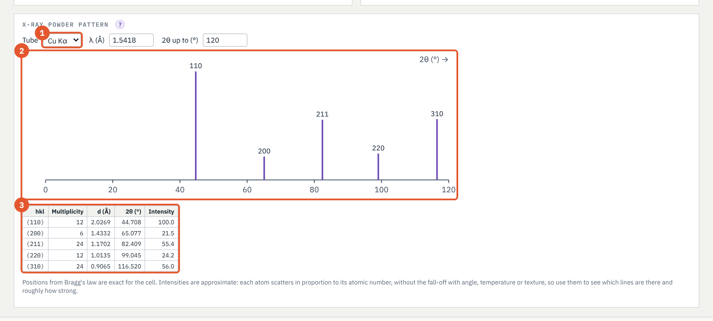

1. **Tube:** Cu, Co, Mo, Cr, Fe or Ag Kα, or type any wavelength.
2. **The pattern:** a line for each family of planes at the 2θ of Bragg's law, as high as its rough intensity. Families the structure cancels, such as (100) in BCC or (200) in diamond, are left out.
3. **The table:** indices, multiplicity, spacing, 2θ and intensity.

The positions are exact for the cell; the intensities are approximate (each atom scatters in proportion to its atomic number, without the fall-off with angle), so they show which lines are there and roughly how strong. On the command line: `datum-atlas-cli crystal Fe`, or `--ask` with any structure.

## Compare

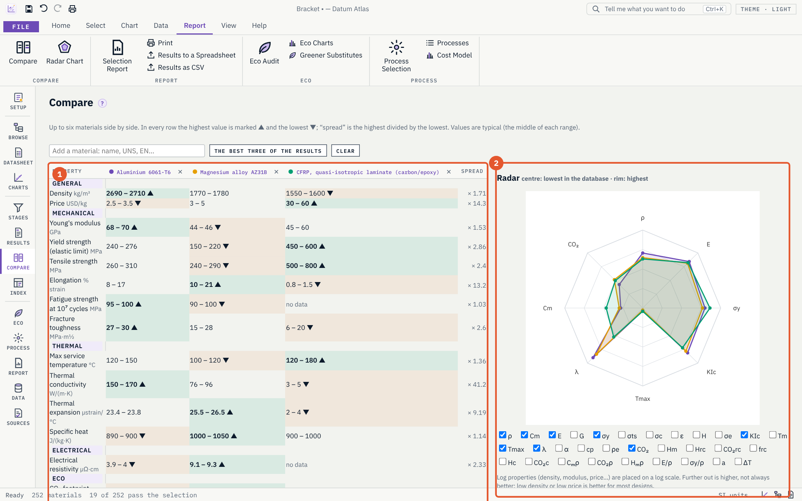

1. **The table.** Up to six materials, property by property: the highest of each row is marked ▲ and the lowest ▼, and **spread** is the highest divided by the lowest.
2. **The radar chart.** Each material's outline, each property placed between the lowest (centre) and the highest (rim) value in the whole database. Tick the properties to show. Further out is higher, not always better: low density or low price is better for most designs.

Add materials with the box at the top, from Results (**+ compare**), from the card beside the chart, or **The best three of the results**.

## Your own materials and databases

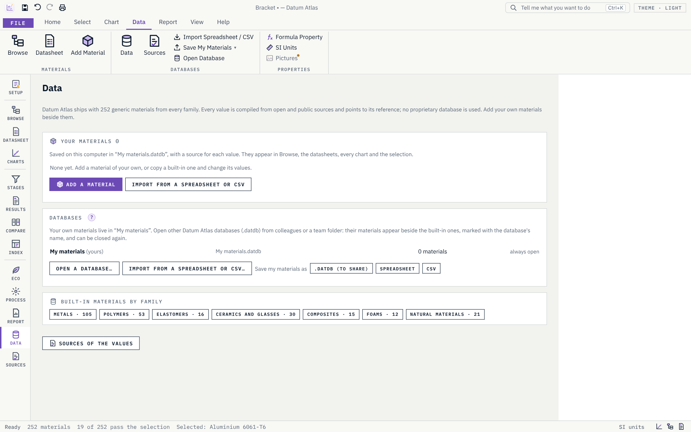

- **Add Material** opens a form that says what is needed: a name, the family, density, at least one more property, the low and high of each value in the unit shown, and where the values come from (a book, a datasheet, a test report or your own measurement).
- **Import Spreadsheet / CSV** reads a table: each column is matched to a property by its heading (change any that are wrong); a cell may hold one value or a range (2690 – 2710); headings in imperial units are converted. You see the rows before they are added, and values that cannot be used are listed, never added as zero.
- **Open Database** opens another `.datdb` (a colleague's, a team folder's) beside the built-in data; its materials are marked with its name and can be closed again.
- **Save My Materials** writes your materials as a `.datdb` to share, a spreadsheet or CSV.

## The eco audit

The eco audit adds up the energy and CO₂ of a product through its life: making its materials, manufacture, transport, use and the end of its life. It shows which phase matters most, so you know where a change helps.

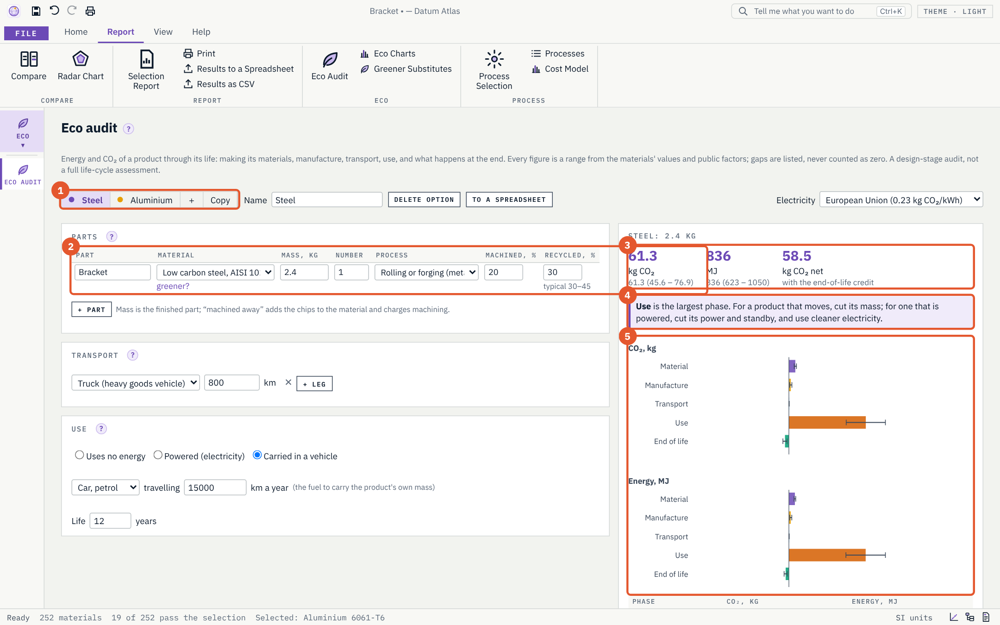

1. **Design options.** Up to four versions of the product; **Copy** one to change one thing (another material, a lighter design).
2. **Parts.** Each part's material, finished mass and number; its process; the share **machined** away (it adds to the material bought and charges machining); its **recycled** content (the typical share of today's supply is shown); and its **end of life**: landfill, burn for energy, downcycle, recycle or not counted.
3. **The totals:** CO₂ and energy for the first four phases, with their ranges, and the net CO₂ with the end-of-life credit.
4. **The largest phase**, and what usually helps for it.
5. **The phase bars**, CO₂ and energy, each with its range.

Below the parts, **Transport** takes legs by sea, rail, road or air with their distances, and **Use** is either **Powered** (kW, hours a day, days a year, on the electricity grid chosen at the top) or **Carried in a vehicle** (the fuel to carry the product's own mass, for the distance travelled a year), for a life in years.

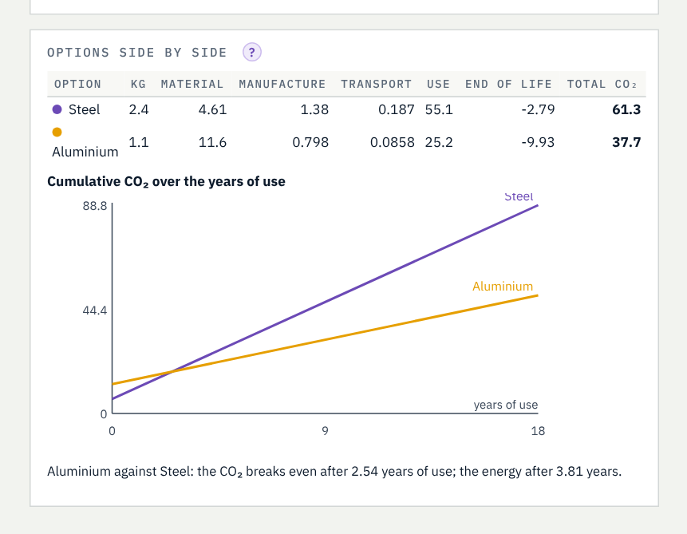

With two or more options, **Options side by side** compares them phase by phase, and the chart draws each option's CO₂ against years of use: what it costs to make is where its line starts, and the use phase is its slope. Where the lines cross, the options **break even**.

Every figure is a range from the values' own ranges and public factors (freight, vehicles, electricity in eleven countries and regions, process energy). A material without a value is listed in the notes, never counted as zero. This is a design-stage audit, not a full life-cycle assessment. The audit goes into the report, and **To a spreadsheet** saves every option, phase and part.

### Greener substitutes

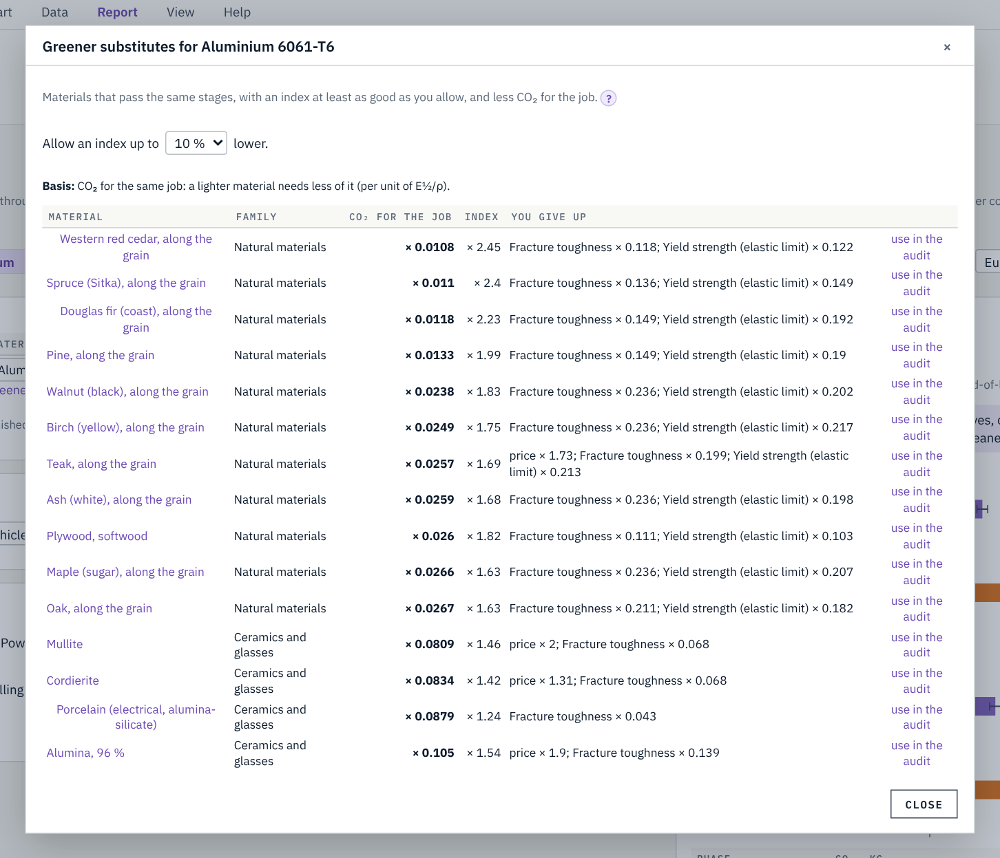

**Greener substitutes** (from a datasheet, the ribbon or **greener?** beside an audit part) lists materials that pass the same stages, with an index nearly as good (you choose how much lower is allowed), and less CO₂ **for the same job**. With a minimum-mass index such as E½/ρ, a better index means less material, so CO₂ for the job is CO₂ per kilogram divided by the index. **You give up** lists price and properties at least 20 % worse. **Use in the audit** swaps the part's material.

## Process selection

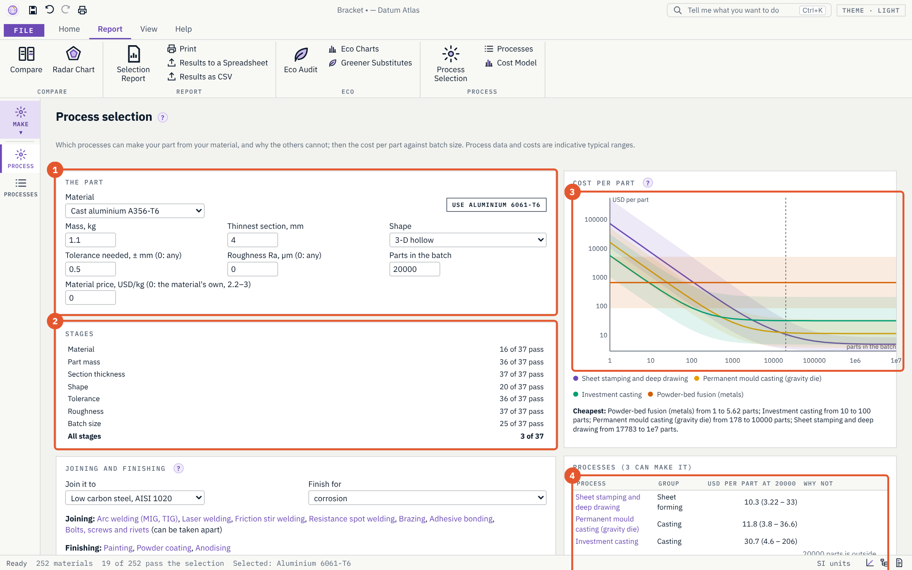

1. **The part:** its material (or **Use …** for the one picked on a chart), mass, thinnest section, shape (flat, sheet, prismatic, 3-D solid, 3-D hollow), the tolerance and surface roughness it needs, the number of parts, and the material price (0 uses the material's own).
2. **Stages:** how many of the processes pass each requirement, and all of them.
3. **Cost per part** against batch size, on log axes: material (with what is wasted) + tooling shared over the batch + the machine's hourly cost divided by its rate. Tooling makes small batches dear; where the curves cross, the cheapest process changes, and the line below the chart says which is cheapest for which batch sizes. The dashed line is your batch size.
4. **Processes:** those that can make the part first, cheapest first; every other one says what stops it (*does not work this alloy*, *cannot make a 3-D hollow part*, *its best tolerance is ±0.8 mm*, *outside its economic batch*).

Below them: **Joining and finishing** lists ways to join the material to itself or to another, and finishes for what you need (corrosion, wear, decoration…); **Processes for the shortlist** shows which processes work the materials in Compare or the best of the results. **Report › Processes** lists every process record; click one for its card. Process data and costs are indicative typical ranges, not quotes: ask your supplier.

## The report, printing and export

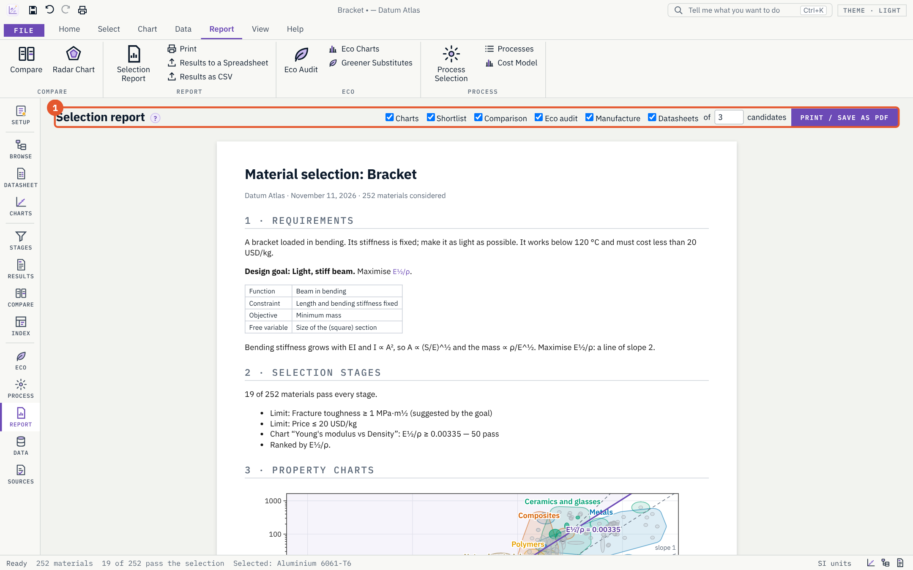

1. Choose what the report holds: the requirements and the design goal, the stages, the **charts**, the **shortlist**, the **comparison**, the **eco audit**, the **manufacture**, and the **datasheets** of the best candidates with their sources. **Print / Save as PDF** prints it.

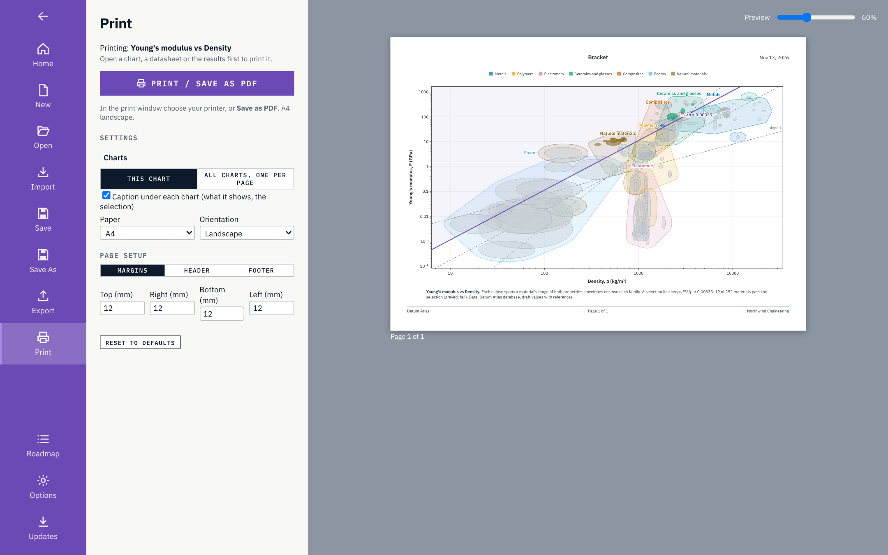

**File › Print** ([[Ctrl+P]]) prints the open chart (vector, with its legend and a caption), a datasheet, the results or the report, with page setup, margins, headers and footers. Choose **Save as PDF** in the print window for a PDF.

Other ways out:

- **Chart › Export:** the chart as SVG (sharp at any size) or PNG (at the resolution in Options). **Copy Picture** puts it on the clipboard for a document or a slide.
- **Results** and the **eco audit** as `.xlsx` or `.csv`.
- **Your materials** as `.datdb`, `.xlsx` or `.csv`.

## The command line and AI assistants

Every release has a small program beside the installer, `datum-atlas-cli-x.y.z.exe`. It does what the window does, from a command prompt:

| Command | What it does |
| --- | --- |
| `search 6061` | Materials by name, designation or use |
| `material al-6061-t6` | A datasheet: values, units, sources, ✓ |
| `new beam bracket.datlas` | Start a project from a design problem |
| `results bracket.datlas --csv` | Every material ranked, and why the others fail |
| `ops` | The named edits, each with an example |
| `apply bracket.datlas --op '…' --save new.datlas` | Change a project with a named edit |
| `eco`, `process`, `substitutes` | The eco audit, process selection, greener substitutes |
| `export bracket.datlas results.xlsx` | Save as .datlas, .xlsx or .csv |

`--db mine.datdb` adds a database of your own. Nothing is saved unless you say `--save` or `export`.

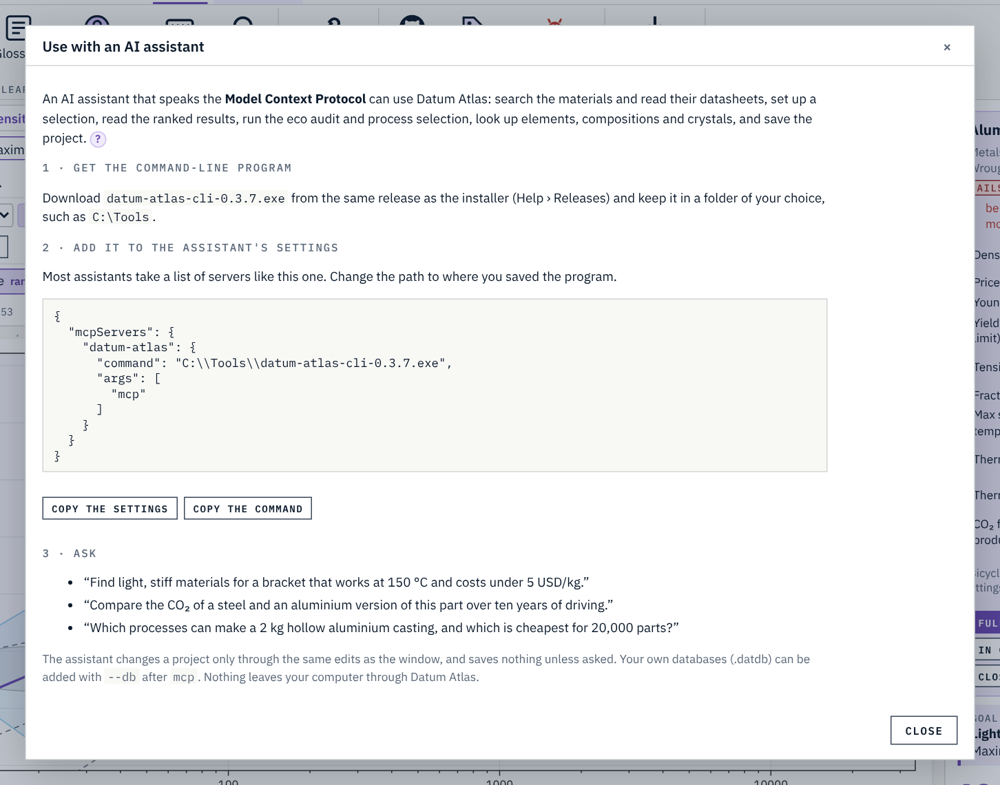

`datum-atlas-cli mcp` connects an AI assistant that speaks the Model Context Protocol. The assistant can search the materials and read their datasheets, set up a selection with the same edits as the window, read the ranked results, run the eco audit and process selection, look up elements, compositions and crystals, and save the project when you ask. **Help › Use with an AI Assistant** has the settings to copy into the assistant.

## Help, options and shortcuts

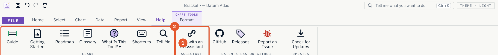

1. **Learn:** **Getting Started** (the method in one page), **Roadmap** (what each coming release brings), **Glossary** (bubble, envelope, index, × best, life phases, economic batch… with a search box), **What Is This Tool?** (every ? card), **Shortcuts** and **Tell Me**.
2. **Assistant:** how to connect an AI assistant.

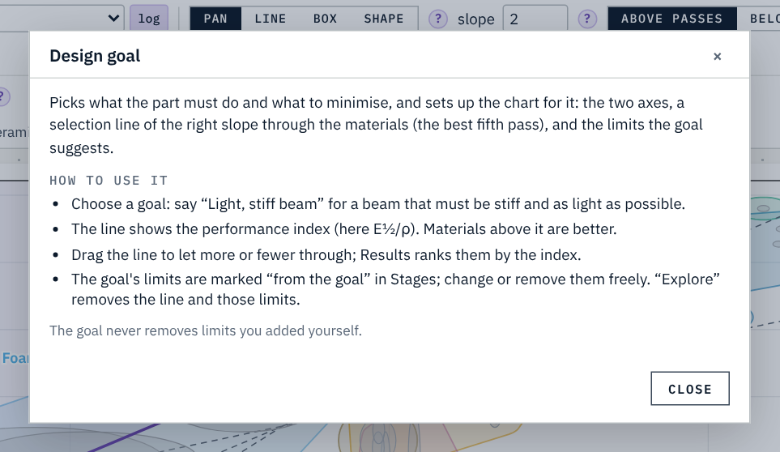

**File › Options:** the theme (light, dark, or auto with Windows), SI or imperial units, autosave every few minutes, labels and guide lines on new charts, the picture resolution, paper size and orientation, and your company name and logo for printed pages.

| Keys | What they do |
| --- | --- |
| [[Ctrl+K]] or [[Alt+Q]] | Tell Me: find a command, a goal or a material |
| [[Ctrl+N]] [[Ctrl+O]] [[Ctrl+S]] | New (File › Home), open, save |
| [[Ctrl+Shift+S]] | Save As |
| [[Ctrl+P]] | Print |
| [[Ctrl+Z]] [[Ctrl+Y]] | Undo, redo |
| Wheel, drag | Zoom and pan the chart |
| Arrow keys | Move the active selection line ([[Shift]]: ten times further) |
| [[Ctrl+C]] | Copy the selected table cells |
| [[F1]] | Keyboard shortcuts |

If Datum Atlas closes before you save, it offers to recover your work the next time it starts.

> **Tip.** Report a problem or ask for a feature with **Help › Report an Issue**. Corrections to a value, with a reference, are welcome.
